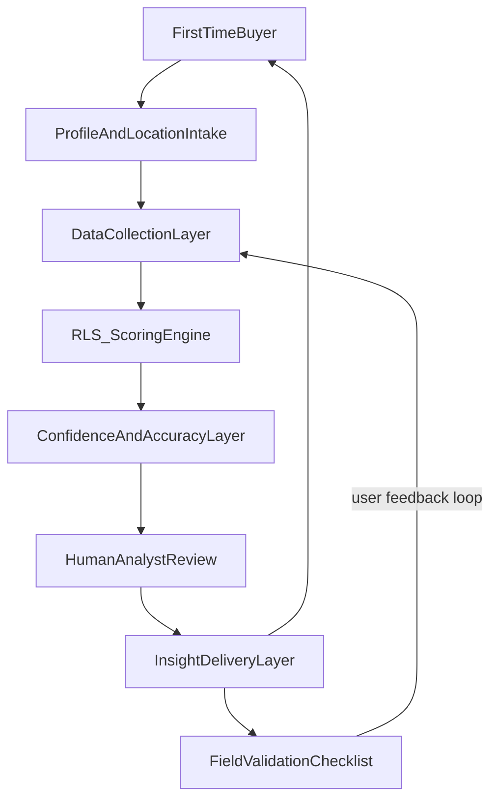
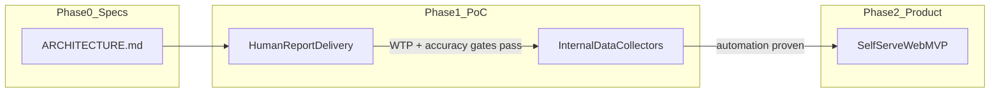
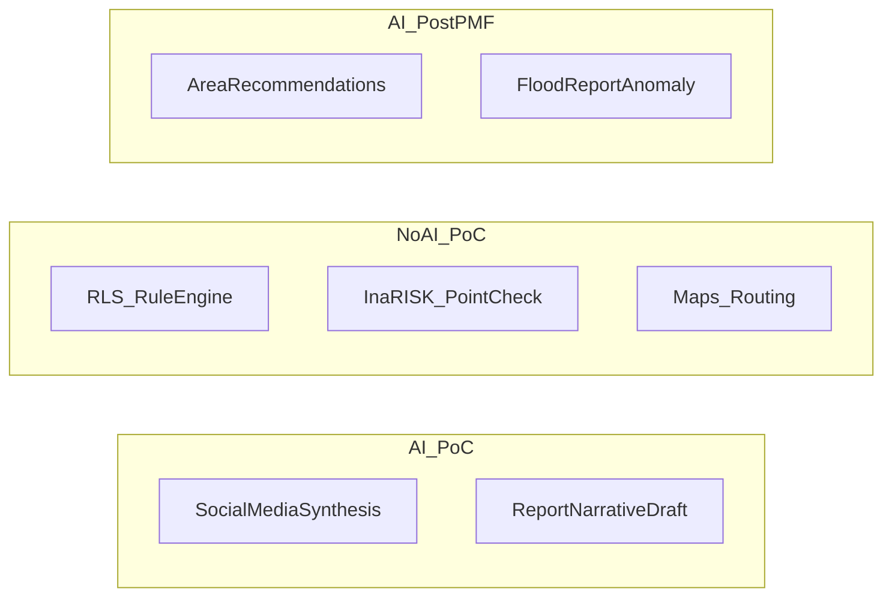

# Rumper — Architecture & Feasibility Specification

> **Status:** Draft v1.0 — Specs-Driven Pre-Build  
> **Last Updated:** June 2026  
> **Scope:** Jabodetabek, Phase 0–1 (PoC)  
> **Canonical references:** [context.md](context.md) · [RUMPER — BUSINESS & PRODUCT PLAN.md](RUMPER%20—%20BUSINESS%20&%20PRODUCT%20PLAN.md) · [PRD rumah pertama.md](PRD%20rumah%20pertama.md)

This document is the **single technical and feasibility spec** for Rumper. It defines what we intend to build, where data comes from, how we close the buyer information gap, how we measure feasibility, and what we deliberately do **not** build yet. No code is implied here — implementation follows after gates pass.

---

## Table of Contents

1. [At-a-Glance](#1-at-a-glance)
2. [Problem-to-Gap Analysis](#2-problem-to-gap-analysis)
3. [Competitor & Platform Benchmark Research](#3-competitor--platform-benchmark-research)
4. [Target System Architecture](#4-target-system-architecture)
5. [AI Strategy](#5-ai-strategy)
6. [Feasibility Measurement Framework](#6-feasibility-measurement-framework)
7. [PoC Scope Boundary](#7-poc-scope-boundary)
8. [Phased Evolution Roadmap](#8-phased-evolution-roadmap)
9. [Open Decisions Register](#9-open-decisions-register)
10. [Appendix: Data Source Registry](#10-appendix-data-source-registry)

---

## 1. At-a-Glance

### Product

**Rumper** — Location Risk Advisor for first-time homebuyers in Jabodetabek.

> *Sebelum beli rumah, kenali risikonya.*

Listing platforms sell houses. Rumper sells **confidence in choosing the right location** — before booking fee or down payment (DP).

### Core Hypothesis

> If first-time homebuyers receive a clear, personalized location risk score, they will evaluate locations more confidently and make fewer decisions they regret.

*(Source: [context.md](context.md) §7.1)*

### First Pain to Solve (PoC Scope)

Focus on **Moment 2 + Moment 3** in the buyer journey:

| Moment | User question | PoC deliverable |
|---|---|---|
| **Moment 2 — Evaluate candidates** | "Of my shortlist, which location has acceptable risk?" | RLS score + dimension breakdown for 1–2 addresses |
| **Moment 3 — Pre-DP validation** | "What must I verify before I pay?" | Field survey checklist + confidence labels + red flags |

**Primary persona at PoC:** Almost-DP couple or commuter first buyer with 1–3 serious candidates and DP decision within ~30 days. *(Business Plan §4)*

### Not in PoC

- Area discovery / alternative recommendations
- Property listing integration
- Price appraisal or KPR certificate vision
- Full automation of all 5 risk dimensions
- Self-serve web platform (target state, not PoC delivery)
- ML-based scoring or autonomous AI agent for buyers

### System Overview



### Specs-Driven Phasing

Execution stays lean; the architecture spec stays stable across phases:



**PoC delivery** = concierge PDF via WhatsApp (human analyst). **Target product** = self-serve web dashboard ([context.md](context.md) §7.3). Both share the same logical components defined in §4.

---

## 2. Problem-to-Gap Analysis

### Root Cause

No tool consolidates fragmented location-risk information into insights a non-expert buyer can act on before financial commitment.

### Pain-to-Gap Map

| Pain (documented) | Current alternatives | What they actually do | Gap Rumper fills |
|---|---|---|---|
| **Flood claims unverifiable** ("bebas banjir") | InaRISK/BPBD maps, Dataruma flood tier | Govt GIS for experts; Dataruma gives low/med/high tier inside appraisal flow | Buyer-friendly synthesis + social/historical verification + explicit confidence label |
| **Commute reality unknown** | Google Maps, listing "15 min to Jakarta" | User must run routes themselves; listings use straight-line or off-peak claims | Personalized rush-hour simulation + monthly cost estimate tied to user's office |
| **Fragmented location data** | Forums, Facebook groups, Kaskus, agents | Peer anecdotes, biased sales talk | Single structured report with cited sources |
| **No comparison framework** | Spreadsheets, gut feel | Ad-hoc, not standardized | RLS V1 weighted score (Business Plan §8) |
| **Pre-DP anxiety** | Home inspectors, KPR agents | Building condition or finance only — not location livability | Independent location audit before booking fee |
| **Red flags hidden** (TPA, SUTET, industry) | Street View, word of mouth | Buyer discovers on site visit or never | Proactive radius scan + checklist prompts |

### Explicit Non-Goals for PoC

| Domain | Why out of scope |
|---|---|
| **Price appraisal** | Dataruma / bank KJPP territory; different trust model |
| **Agent replacement** | Homa/Nestment full-journey model; different business |
| **Full AI homebuying coach** | Education at scale ≠ location risk audit |
| **Developer partnerships** | Conflicts with independence positioning |

### What Success Looks Like for the Buyer

A user receives, within 48 hours:

1. **One clear verdict** — Green / Yellow / Red RLS label
2. **Why** — per-dimension breakdown (flood, commute, access, amenities, red flags)
3. **What to verify on site** — personalized checklist
4. **Honest limits** — confidence labels where data is weak

---

## 3. Competitor & Platform Benchmark Research

Research focus: **what similar businesses actually do** with platforms, data, and AI — not feature parity.

### A. Location / Climate Risk Engines (closest analog)

#### First Street Foundation / Risk Factor (US)

- **Primary job:** Property-level physical climate risk scores (flood, fire, heat, wind) on 1–10 scale
- **Data:** Government elevation models, hydrology, climate projections, building characteristics; published peer-reviewed methodology
- **Delivery:** Free consumer lookup (riskfactor.com); API for enterprises; embedded in Redfin, Realtor.com
- **AI role:** None for scoring — deterministic scientific models
- **Accuracy approach:** Methodology PDFs, versioned models, peril-level confidence

**Lesson for Rumper:** Simple score + transparent methodology + government data anchor. In Indonesia, **InaRISK BNPB** is the equivalent anchor — not a proprietary model at PoC.

#### ClimateCheck (US / global)

- **Primary job:** 1–100 climate hazard scores per property; portfolio screening
- **Data:** Predictive hazard models; API and bulk data feeds for real estate stakeholders
- **AI role:** Model-driven, not LLM-driven

**Lesson for Rumper:** Actionable numeric score beats raw GIS layers for consumers.

---

### B. Indonesia PropTech (local context)

#### Dataruma — Ekuitas Home

- **Primary job:** Instant property appraisal + location data for buy/sell decisions
- **Data:** Real-time market prices, government data, AI-assisted valuation (bank/KJPP methodology)
- **Location risk:** Flood risk tier (low / medium / high) as one input among price, facilities, etc.
- **Delivery:** Digital report in ~5 minutes; freemium (basic free, detailed paid)
- **Gap vs. Rumper:** Price-first; no deep commute audit, red-flag scan, or field checklist; not positioned as independent pre-DP location audit

#### InaRISK BNPB

- **Primary job:** National disaster risk mapping (flood, landslide, etc.) for government and planners
- **Data:** Official BNPB geospatial layers; IRBI indices per kabupaten/kota
- **Delivery:** WebGIS dashboard — expert-oriented, no buyer UX, no personalization
- **Gap vs. Rumper:** Raw infrastructure Rumper must **translate** into buyer language

#### Listing platforms (Rumah123, Lamudi, OLX)

- **Primary job:** Sell inventory — price, photos, specs
- **Location data:** Marketing copy; no verified risk synthesis

---

### C. AI Homebuying Platforms (US — process patterns)

#### Further (withfurther.com)

- **Primary job:** AI assistant for homebuying education and scenario planning
- **Data:** LLM + real-time housing/financial data inputs
- **AI role:** Conversational guidance; learns user preferences over time
- **Gap vs. Rumper:** General coach, not location-risk certificate

#### Exactly (exactly.homes)

- **Primary job:** Financial buying power + connected decision variables
- **Data:** User-stated finances + market APIs; compares ZIP codes and properties
- **AI role:** "Penny" interprets financial reality into buying range; neighborhood scoring (commute, safety, schools)
- **Lesson for Rumper:** Personalized profile inputs matter; connect variables (office → commute weight)

#### Homa (tryhoma.com)

- **Primary job:** Replace buyer's agent; AI + human experts
- **Data:** Listing analysis, disclosures, climate risk flags in property research
- **AI role:** Pros/cons synthesis; human brokers validate offers
- **Lesson for Rumper:** AI for **analysis draft**, humans for **trust and liability** at early stage

#### Nestment (nestment.com)

- **Primary job:** First-time buyer coaching end-to-end
- **Data:** Proprietary insights + partner network (agents, lenders)
- **AI role:** Supports coach; human relationship is the product
- **Lesson for Rumper:** Human-in-the-loop builds trust before automation scales

---

### Benchmark Takeaway Table

| Platform | Primary job | Data they use | AI role | What Rumper adopts | What Rumper skips |
|---|---|---|---|---|---|
| **First Street** | Climate risk score | Govt + elevation + models | None (deterministic) | Score + methodology transparency + govt anchor | US-specific peril models |
| **ClimateCheck** | Hazard scoring | Model + API feeds | None (deterministic) | 1–100 style simplicity | Portfolio/enterprise focus |
| **Dataruma** | Price appraisal | Market + govt + AI valuation | AI for appraisal math | Flood tier as one dimension | Price/appraisal as core product |
| **InaRISK** | Disaster mapping | BNPB official GIS | None | Primary flood data source | Expert GIS UX |
| **Exactly** | Financial + area fit | User profile + market APIs | LLM interpretation | Profile-driven personalization | US mortgage math |
| **Homa** | Transaction support | Listings + disclosures | AI draft + human review | AI assists, human approves | Commission/rebate model |
| **Nestment** | Full journey coaching | Proprietary + partners | AI assists coach | Human consultation loop | Agent/lender marketplace |
| **Further** | Education + scenarios | LLM + housing data | Primary interface | — | General AI coach scope |

### Strategic Whitespace

**No direct competitor** in Indonesia offers an **independent, buyer-paid location risk audit** combining flood + personalized commute + red flags + field checklist before DP. Closest overlaps are Dataruma (price) and InaRISK (raw data).

---

## 4. Target System Architecture

Logical components are **implementation-agnostic**. PoC may execute them manually; the platform automates them later.

### 4.1 Intake Service

**Purpose:** Capture user context so scores are personalized, not generic.

| Input | Required PoC | Target platform |
|---|---|---|
| Property coordinates or address | Yes | Yes |
| Office / commute destination | Yes | Yes |
| Transport mode preference | Yes | Yes |
| Family status & child plans | Yes | Yes |
| Commute tolerance (minutes) | Yes | Yes |
| Facility priorities | Optional PoC | Yes |
| Budget range | Optional PoC | Yes |

**PoC channel:** Typeform / Google Forms → Google Sheets  
**Target channel:** Web onboarding flow ([context.md](context.md) §7.3)

---

### 4.2 Data Collection Layer

Five RLS dimensions with PoC method, automation path, sources, and feasibility rating.

| Dimension | Weight | PoC method | Automation candidate | Primary sources | Feasibility |
|---|---|---|---|---|---|
| **Flood resilience** | 30% | InaRISK point check + BPBD layer + social keyword search + Google Earth elevation | PostGIS point-in-polygon on BNPB/BPBD layers | [InaRISK BNPB](https://inarisk.bnpb.go.id), BPBD DKI/Jabar/Banten, OSM | **High** availability; property-level resolution **Medium** |
| **Commute efficiency** | 25% | Google Maps departure-time simulation (Tue/Wed 07:00) + KRL station mapping | Distance Matrix API batch; GTFS for KRL | Google Maps Platform, GTFS KCI, TransJakarta open data | Driving **High**; transit **Medium** |
| **Physical access** | 15% | Google Street View road width audit | OSM highway tags + Street View deep links | OSM Overpass, Google Street View | **Low–Medium** — needs human judgment |
| **Essential amenities** | 15% | Google Places radius search (RS, schools, market) | Places API / Overpass automated | Google Places API, OSM | Existence **High**; quality **Medium** |
| **Environmental red flags** | 15% | Manual 1 km radius scan (TPA, SUTET, cemetery, factory) + social/news | OSM landuse + keyword alert pipeline | OSM, manual curation, social media | **Medium** — incomplete POI in Indonesia |

#### Data Collection Flow (logical)

```mermaid
flowchart LR
  subgraph inputs [UserInputs]
    Addr[Address_Coordinates]
    Profile[UserProfile]
  end
  subgraph auto [AutomatableSources]
    InaRISK[InaRISK_BNPB]
    Maps[Google_Maps_API]
    Places[Google_Places]
    OSM[OpenStreetMap]
    GTFS[GTFS_KRL]
  end
  subgraph manual [HumanResearch_PoC]
    Social[SocialMedia_Search]
    StreetView[StreetView_Audit]
    News[LocalNews_Forums]
  end
  subgraph output [CollectedFacts]
    Facts[StructuredFactSheet]
  end
  Addr --> InaRISK
  Addr --> Maps
  Addr --> Places
  Addr --> OSM
  Profile --> Maps
  Profile --> GTFS
  Addr --> Social
  Addr --> StreetView
  Addr --> News
  InaRISK --> Facts
  Maps --> Facts
  Places --> Facts
  OSM --> Facts
  GTFS --> Facts
  Social --> Facts
  StreetView --> Facts
  News --> Facts
```



#### PoC SOP alignment

Manual steps map 1:1 to Business Plan §16 (Operations SOP): verify payment → flood research → commute test → virtual tour → compile → deliver → feedback.

---

### 4.3 Scoring Engine — RLS V1

**Method:** Rule-based weighted average. **Not ML** at PoC or until ≥100 validated reports.

#### Dimension scoring (1–5 per dimension)

| Dimension | Weight | Score 5 (best) | Score 1 (worst) |
|---|---|---|---|
| Flood resilience | 30% | No flooding history 10yr; high elevation | Routine inundation; annual flood risk |
| Commute efficiency | 25% | <45 min single-mode transit to office | >90 min; 3+ transfers; severe congestion |
| Physical access | 15% | Road >6m, paved, near toll | <3m, unpaved, emergency vehicle risk |
| Essential amenities | 15% | RS, school, market <10 min | Critical facilities >30 min |
| Red flags | 15% | Clean environment | TPA/SUTET/factory <200m |

#### Formula

```
RLS = (Flood × 6) + (Commute × 5) + (Access × 3) + (Amenities × 3) + (RedFlags × 3)
```

Maximum = 100.

#### Labels

| RLS range | Label | Meaning |
|---|---|---|
| 80–100 | Green | Low risk — recommended with standard due diligence |
| 55–79 | Yellow | Moderate risk — proceed with noted caveats |
| <55 | Red | High risk — deep evaluation required before DP |

#### Personalization (PoC light-touch)

Adjust narrative emphasis and checklist items by persona — **not** the base weights until validated:

- **Commuter:** Emphasize commute dimension in summary; add rush-hour verification items
- **Family planner:** Emphasize amenities + long-term livability
- **Young family:** Emphasize schools, flood, safety questions for RT/RW

---

### 4.4 Confidence & Accuracy Layer

Extends [context.md](context.md) §9.3 into operational rules.

| Label | Criteria | User-facing behavior |
|---|---|---|
| **Data Kuat** | Official source; updated <1 year; kelurahan+ resolution | Show dimension score with full confidence |
| **Data Sedang** | Trusted but stale or kecamatan-level only | Show score + explicit caveat + "verify on site" |
| **Perlu Validasi** | Estimate, proxy, or social-media-only evidence | Flag dimension; **mandatory** checklist item; do not imply certainty |

**Principle:** Better to admit data limits than appear absolute and be wrong.

#### Accuracy measurement (PoC)

| Metric | Method | Target |
|---|---|---|
| Flood tier agreement | Post-delivery survey vs. user's site visit | ≥80% match (High/Med/Low) |
| Commute tier agreement | User-reported actual commute vs. our estimate | ≥80% within one tier |
| Major correction rate | Reports requiring >20 point RLS revision after feedback | <10% |
| Validation coverage | "Perlu Validasi" items with checklist action | 100% |

#### Feedback loop

```
Delivery → 3-day feedback form → site visit outcomes → calibrate scoring rubric → update SOP
```

Optional: scouting fund runners for critical flood cases (Business Plan §14).

---

### 4.5 Insight Delivery Layer

**Design principles** (from PRD): summary-first, progressive disclosure, decision-oriented language, mobile-friendly share.

#### Presentation rules

| Instead of | Show |
|---|---|
| "Pluvial flood probability 0.34" | Flood Risk: **High** |
| "Distance Matrix: 3420s" | Commute: **~57 min** (Tuesday 07:00, driving) |
| Raw GIS layer | Map snapshot + plain-language interpretation |

#### PoC deliverable structure (PDF)

1. Executive dashboard — RLS score + Green/Yellow/Red
2. Flood analysis — map + history + confidence label
3. Commute analysis — routes, times, monthly cost estimate
4. Physical access — Street View captures + road notes
5. Amenities summary — key distances
6. Red flags — table with radius and severity
7. Custom field survey checklist
8. Methodology & sources appendix
9. Disclaimer — not a substitute for site visit

**PoC channel:** WhatsApp Business + email  
**Target channel:** Web dashboard + shareable link ([context.md](context.md) §7.3)

#### User satisfaction drivers

1. **One clear verdict** in first screen / first PDF page
2. **Explain why** — each dimension has 2–3 sentences, not data dumps
3. **Actionable next steps** — checklist tied to weak dimensions
4. **Source transparency** — every claim traceable
5. **Shareability** — formatted for spouse / parents discussion

---

### 4.6 Human-in-the-Loop (required at PoC)

| Step | Analyst responsibility |
|---|---|
| Pre-score | Validate coordinates; flag missing data |
| Post-score | Review RLS for obvious errors; add local context |
| Narrative | Edit any AI-drafted text (§5) |
| Delivery | 15-min consultation (Comprehensive/Dual packages) |
| Calibration | Log discrepancies for rubric updates |

**Every report is analyst-approved before send.** No autonomous delivery at PoC.

---

### 4.7 Target Platform Stack (Phase 3 reference)

Not built at PoC — documented for spec stability:

| Layer | Choice | Rationale |
|---|---|---|
| Frontend | Next.js + React | SSR/SEO; mature ecosystem |
| Maps | Mapbox GL JS or Leaflet + OSM | Cost vs. polish tradeoff |
| Backend | Python FastAPI or Node.js | Python preferred for geo ETL |
| Database | PostgreSQL + PostGIS | Spatial queries required |
| Data pipeline | Python Pandas/GeoPandas | Industry standard for geospatial |
| Hosting | Vercel + Railway/Render | Fast MVP deploy |

---

## 5. AI Strategy

Honest scope: **AI assists research and explanation; it does not own the score.**

### Where AI Helps Now (Phase 1 PoC)

| Use case | Input | Output | Guardrail |
|---|---|---|---|
| Social flood synthesis | Area keywords + social posts | Bullet summary of reported incidents | Analyst verifies; label "Perlu Validasi" if social-only |
| Report narrative draft | Structured fact sheet | Section paragraphs for PDF | Human edits every section before send |
| Internal research assistant | Analyst queries | Source suggestions, translation | Not user-facing |

### Where AI Does NOT Belong in PoC

| Excluded use | Reason |
|---|---|
| Final RLS calculation | Must be reproducible, auditable, rule-based |
| Replacing field survey checklist | Physical verification cannot be automated |
| Autonomous property recommendations | Post-MVP; needs validated accuracy first |
| Replacing InaRISK/BPBD for flood zoning | Government data is authoritative anchor |
| User-facing autonomous chat agent | Trust risk before PMF; scope creep |

### Future AI (post-validation gates)

| Use case | Prerequisite |
|---|---|
| Personalized area suggestions | ≥100 reports; ≥80% accuracy on flood/commute |
| Anomaly detection on user flood reports | Crowdsourced data pipeline exists |
| Multi-agent research pipeline | Semi-auto data layer proven (Phase 2) |



---

## 6. Feasibility Measurement Framework

Gates must pass before advancing phase. **Do not build ahead of validation.**

### 6.1 Data Feasibility Gates (pre-build / Week 1)

| Gate | Test | Pass criteria | Owner |
|---|---|---|---|
| **DF-1** Flood resolution | Point-check 10 Jabodetabek addresses in InaRISK + BPBD | ≥7/10 return usable kelurahan-level classification | Data / Founder |
| **DF-2** Commute accuracy | Google Maps 07:00 estimate vs. 5 real commuter self-reports | Median error <15 minutes | Data |
| **DF-3** Amenities coverage | Places API radius search in 5 suburban clusters | Schools + hospitals within 15 min drive for ≥80% of points | Data |
| **DF-4** Red flag detection | Manual audit 10 known sites (TPA, SUTET, industry) | Document false positive/negative rate; establish baseline | Analyst |

### 6.2 Product Feasibility Gates (30-day sprint)

From Business Plan §15:

| Gate | Metric | Pass criteria |
|---|---|---|
| **PF-1** Willingness to pay | Paid reports in first 15 days post-launch | ≥10 Comprehensive or Dual-Location packages |
| **PF-2** Unit economics | CAC vs. AOV | CAC < Rp150,000; AOV ≥ Rp300,000 |
| **PF-3** Delivery speed | Analyst time per comprehensive report | <2.5 hours average |
| **PF-4** Satisfaction | Post-delivery NPS | ≥80% of customers score ≥8/10 |

### 6.3 Accuracy & Trust Gates (architecture-specific)

| Gate | Metric | Pass criteria |
|---|---|---|
| **AT-1** Site visit agreement | User survey after physical survey | ≥80% say flood + commute assessment "matches reality" |
| **AT-2** Correction rate | Major post-delivery revisions | <10% of reports |
| **AT-3** Validation completeness | "Perlu Validasi" dimensions | 100% include checklist action items |

### 6.4 Technical Feasibility Gates (before web platform)

| Gate | Metric | Pass criteria |
|---|---|---|
| **TF-1** SOP automation map | Each manual SOP step | Documented API/tool replacement |
| **TF-2** Scoring reproducibility | Same inputs re-run | RLS within ±2 points |
| **TF-3** Pipeline cost | API + tooling per report at 20/mo | <Rp50,000 variable cost |

### Gate Decision Matrix

| If passes | Action |
|---|---|
| DF-1 to DF-4 only | Proceed with PoC concierge delivery |
| PF-1 to PF-4 | Invest in semi-automation (Phase 2) |
| AT-1 to AT-3 | Increase automation confidence; reduce human review time |
| TF-1 to TF-3 | Begin Next.js platform build (Phase 3) |

---

## 7. PoC Scope Boundary

### In Scope — First Pain Only

- Single or dual location audit report (Rp149k–499k tiers)
- Flood + commute + top red flags (full five dimensions in Comprehensive tier)
- RLS V1 score with per-dimension confidence labels
- Custom field survey checklist
- Human-reviewed PDF delivery within 48 hours
- 15-minute post-report consultation (Comprehensive/Dual)
- Jabodetabek geographic coverage only
- Landed houses primary; apartments on request

### Out of Scope — Until Gates Pass

| Item | Defer until |
|---|---|
| Next.js web app | TF gates + PF gates |
| User accounts / shortlist saving | Phase 3 |
| ML-based scoring | ≥100 validated reports |
| Property listing integration | PMF + neutrality policy tested |
| Nationwide expansion | Jabodetabek PMF proven |
| B2B API / KPR certificate | Phase 3+ vision |
| Automated red-flag ML | DF-4 baseline + labeled dataset |
| Real-time flood monitoring | Not core to pre-DP decision |
| AI-generated area recommendations | AT gates pass |
| Free self-serve tier | WTP validated (PF-1) |

### Problems Not Requiring App/AI

Some buyer pains are better solved with **process and checklist**, not software:

| Pain | PoC solution | Why not over-engineer |
|---|---|---|
| "What do I ask the RT head?" | Checklist questions in PDF | Template + human context suffices |
| "Is the agent lying about flood?" | Evidence table + confidence label | Trust comes from sources, not algorithm |
| "Should I trust this developer claim?" | Side-by-side data vs. claim | Analyst judgment, not LLM |
| Family alignment on decision | Shareable PDF | Format problem, not AI problem |

---

## 8. Phased Evolution Roadmap

Spec-stable evolution aligned with Business Plan §17:

| Phase | Volume | Delivery | Data automation | AI | Key milestone |
|---|---|---|---|---|---|
| **0 — Specs** | — | This document | Research protocols defined | Research only | ARCHITECTURE.md approved |
| **1 — PoC** | 0–20/mo | Concierge PDF + WhatsApp | Analyst manual per SOP | Draft synthesis only | PF gates pass |
| **2 — Semi-auto** | 21–100/mo | Airtable + PDF automation (Zapier/Make) | API pipelines: flood, commute, amenities | Same as Phase 1 | <1 hr/report |
| **3 — Platform** | 100+/mo | Next.js self-serve | PostGIS + scheduled refresh | Exploratory recommendations | TF gates pass |

### Phase 1 tooling (no custom code)

| Function | Tool |
|---|---|
| Landing page | Carrd / Webflow |
| Intake + payment | Typeform + Midtrans / bank transfer |
| Internal DB | Google Sheets |
| Report template | Google Slides → PDF |
| Customer comms | WhatsApp Business |

### Phase 3 tooling (target — from context.md)

| Function | Tool |
|---|---|
| Frontend | Next.js + React on Vercel |
| Backend | FastAPI / Node on Railway |
| Spatial DB | PostgreSQL + PostGIS |
| Geo ETL | Python GeoPandas |
| Maps | Mapbox or Leaflet + OSM |

---

## 9. Open Decisions Register

Consolidated from all three source docs. **PoC default** enables execution without blocking.

| ID | Question | PoC default | Defer full decision until |
|---|---|---|---|
| Q1 | Scoring method: weighted average or ML? | Rule-based RLS V1 | ≥100 validated reports |
| Q2 | Flood data resolution available? | InaRISK + BPBD + manual social verify | DF-1 gate results |
| Q3 | Landed only or apartments too? | Landed primary; apartments on request | User demand signal |
| Q4 | Sparse data locations? | Force "Perlu Validasi" + checklist; no false precision | Never auto-score low-confidence |
| Q5 | User accounts needed? | No — PDF delivery sufficient | Phase 3 platform |
| Q6 | Best share format? | PDF via WhatsApp + email | After 20 paid users |
| Q7 | Infrastructure plan data source? | Manual curation (RTRW, news) — not in Basic tier | Semi-auto phase |
| Q8 | Product language? | Bahasa Indonesia for user-facing content | Consistent across PoC |
| Q9 | MVP gating metric? | Paid reports + post-visit accuracy (PF + AT gates) | Day 30 review |
| Q10 | Acquisition channel? | TikTok/Reels organic + community guerrilla | CAC data from PF-2 |
| Q11 | MVP format: concierge vs. web? | Concierge delivery; web is Phase 3 target | PF-1 passes |
| Q12 | Monetization at MVP? | Paid from day 1 (Rp149k–499k) | — |
| Q13 | Neutrality under monetization? | No developer commissions; editorial policy in report | Ongoing |
| Q14 | Primary user moment? | Moment 2 + 3 (evaluate + pre-DP) | — |

### ADR Candidates (future)

When implementation begins, convert these to Architecture Decision Records:

1. ADR-001: Rule-based RLS V1 as scoring engine
2. ADR-002: InaRISK BNPB as primary flood authority
3. ADR-003: Human-in-the-loop required for all PoC reports
4. ADR-004: Concierge-before-platform delivery strategy

---

## 10. Appendix: Data Source Registry

| Category | Source | URL / access | License | Spatial resolution | Refresh cadence | Cost | PoC usage | Platform usage |
|---|---|---|---|---|---|---|---|---|
| Flood / disaster | InaRISK BNPB | inarisk.bnpb.go.id | Government open | Kabupaten/kelurahan layers | Annual (IRBI updates) | Free | Primary — manual point check | PostGIS polygon store |
| Flood / disaster | BPBD DKI/Jabar/Banten | Regional portals | Government open | Varies by region | Event-driven | Free | Supplement InaRISK | Layer overlay |
| Flood / disaster | OpenStreetMap | openstreetmap.org | ODbL | Variable | Community | Free | Drainage, waterways | OSM sync pipeline |
| Commute | Google Maps Platform | maps.google.com/platform | Commercial API | Route-level | Real-time | Pay per request | Manual simulation | Distance Matrix API |
| Commute | HERE Routing API | developer.here.com | Commercial API | Route-level | Real-time | Pay per request | Backup option | Backup routing |
| Transit | GTFS KCI (KRL) | KAI / open data portals | Open | Station-level | Periodic | Free | Station distance manual | GTFS routing |
| Transit | TransJakarta | Jakarta open data | Open | Corridor/stop | Periodic | Free | Halte proximity | Transit layer |
| Amenities | Google Places API | maps.google.com/platform | Commercial API | POI-level | Real-time | Pay per request | Manual search | Automated radius |
| Amenities | OSM Overpass | overpass-api.de | ODbL | POI-level | Community | Free | Supplement | Batch queries |
| Density | BPS Sensus | bps.go.id | Government open | Kelurahan | Census cycle | Free | Optional context | Demographic layer |
| Air quality | KLHK ISPU | ispu.menlhk.go.id | Government open | Station-level | Hourly | Free | Not PoC priority | Environmental layer |
| Air quality | OpenAQ | openaq.org | Open | Station-level | Hourly | Free | Not PoC priority | Supplement |
| Elevation | Google Earth | earth.google.com | Free tool | Visual | On-demand | Free | PoC contour check | DEM alternative |
| Street imagery | Google Street View | maps.google.com | Free tool | Street-level | Periodic | Free | PoC access audit | Deep links in report |
| Area growth | Property listings | Rumah123, etc. | Scraping risk | Listing-level | Real-time | Legal risk | Out of PoC | Phase 3+ if licensed |
| Area growth | JLL / Colliers reports | Commercial | Licensed | Market-level | Quarterly | Paid | Not PoC | Secondary |
| Infrastructure plans | RTRW / government docs | Regional | Public | Zoning-level | Multi-year | Free | Manual research | Curated DB |
| Social verification | Twitter/X, Facebook, YouTube | Social platforms | Public UGC | Event-level | Real-time | Free | Keyword search | AI-assisted synthesis |
| Field verification | Local runners (scouting fund) | Internal | — | Property-level | On-demand | Rp per visit | Critical flood cases | Surveyor portal Phase 3 |

---

## Related Documents

| Document | Purpose |
|---|---|
| [context.md](context.md) | Product requirements, personas, features, metrics |
| [RUMPER — BUSINESS & PRODUCT PLAN.md](RUMPER%20—%20BUSINESS%20&%20PRODUCT%20PLAN.md) | Business validation, pricing, GTM, SOP, funding |
| [PRD rumah pertama.md](PRD%20rumah%20pertama.md) | English PRD, UX principles, future enhancements |

---

## Immediate Next Actions (from this spec)

1. Run **DF-1 to DF-4** data feasibility tests on 10 real Jabodetabek addresses
2. Produce report template (Google Slides) matching §4.5 deliverable structure
3. Execute 30-day PoC sprint per Business Plan §12
4. Log every report's accuracy feedback for AT gate measurement
5. Convert Q1–Q14 decisions into ADRs when implementation starts

---

*This is a living document. Update after each validation sprint with gate results and revised feasibility ratings.*
