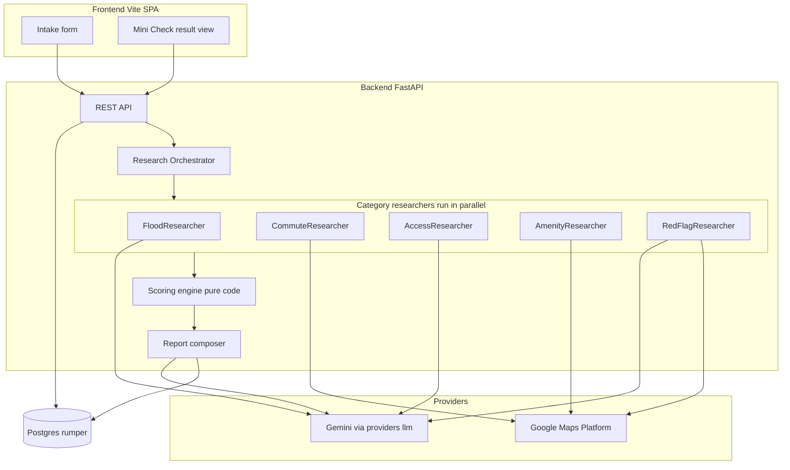

# 01 — Prototype Architecture

## 1. Topology

## 2. Request lifecycle

1. `POST /api/intakes` validates input, geocodes the property + workplace
   (Geocoding API; reject/flag outside Jabodetabek per SOP-RSCH-001 decision gate),
   persists the intake, creates a `research_job` (`pending`), and starts the pipeline
   as a FastAPI background task. Returns `intake_id` immediately.
2. Orchestrator marks the job `running`, builds the **research brief** (structured intake
   facts), and runs the five researchers concurrently with per-category timeouts
   (doc 06 §5). Each returns `Finding[]` + a proposed category score with rationale.
3. Scoring engine (doc 07) applies deterministic clamps, weights, band, red-flag
   override, and recommendation. No LLM involvement.
4. Report composer asks Gemini for the Bahasa Indonesia narrative **from the structured
   fact sheet only** (structured output; no new facts allowed), assembles the Mini Check
   JSON, persists everything, marks the job `done`.
5. Frontend polls `GET /api/checks/{intake_id}` until `status=done`, then renders.

## 3. Failure model

- A researcher failing or timing out → category recorded as **evidence gap**
  (`Perlu validasi`, no score, mandatory checklist item); the job still completes.
- Geocoding failure → job `failed` with a user-actionable message (ask for a Google
  Maps pin — mirrors SOP exception "minta pin").
- Composer failure → retry once; on second failure serve the structured Mini Check
  without narrative (fields are sufficient to render).

## 4. Trust boundaries

- LLM output is **proposals + prose**, always validated against Pydantic schemas;
  scores clamped by code; citations must come from grounding metadata, never free text.
- The Mini Check is labeled *preliminary* in the API payload (`report_type:
  "mini_check_preliminary"`) and in the UI; concierge/full reports stay human-reviewed.
