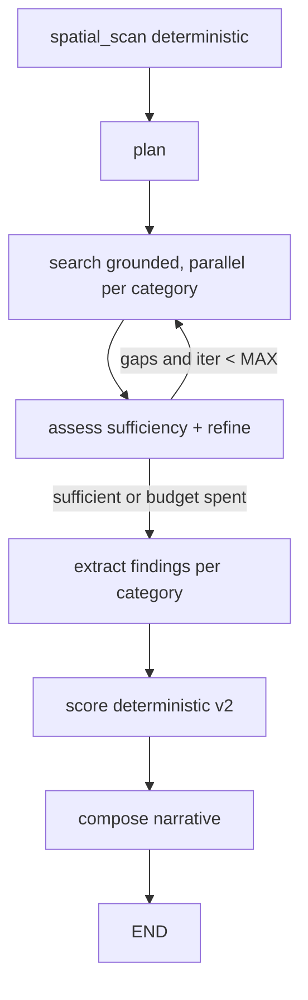

# 11 — Deep Research Graph (LangGraph)

Replaces the single-pass researchers of docs/06 with an iterative, Gemini-Deep-Research
style workflow: **plan → search → assess sufficiency → refine queries → loop → extract →
score → compose**. Built with LangGraph (nihonjung pattern: TypedDict state, node
functions, compiled singleton). All runs traced to **LangSmith** (`LANGSMITH_TRACING=true`,
project `rumper`); provider calls wrapped with `@traceable`.

## 1. Graph



- **Textual categories in the loop:** `banjir`, `akses`, `lingkungan`.
- **Deterministic categories:** `commute` (Routes API) and `fasilitas` (warehouse) are
  computed inside `spatial_scan` — no LLM, no loop.

## 2. State

```python
class ResearchState(TypedDict, total=False):
    brief: dict                 # ResearchBrief
    spatial: dict               # SpatialFacts (doc 10 §4)
    plans: dict[str, list[str]]         # category -> pending queries
    notes: dict[str, list[dict]]        # category -> accumulated {query, text, sources}
    iteration: int
    done_categories: list[str]
    results: dict[str, dict]            # category -> CategoryResult
    engine: dict
    summary: str
```

## 3. Nodes

**spatial_scan** — builds SpatialFacts (doc 10 §4); computes `commute` + `fasilitas`
CategoryResults deterministically; converts warehouse red-flag features and flood/
elevation facts into seed findings for the textual categories.

**plan** — one structured LLM call. Input: brief + SpatialFacts summary. Output: 2–3
*targeted* queries per textual category, in Bahasa Indonesia, that go beyond what the
warehouse already shows (e.g. if InaRISK says `tinggi` and the land is low-lying, plan
queries about specific kali names and recent events; if a landfill is 1.2 km away, plan
queries about smell/complaints). Generic queries are wasted budget.

**search** — for every (category, query) pending: grounded Gemini call (Google Search
tool). Appends `{query, text, sources}` notes. Parallel via `asyncio.gather`; per-call
timeout 45 s; failures append an empty note (assess sees the gap).

**assess** — one structured LLM call over all notes: per category returns
`sufficient: bool` + `missing: str` + up to 2 `refined_queries`. Router edge:
categories with refined queries and `iteration < MAX_ITERATIONS (2)` go back to
**search**; otherwise to **extract**. This is the query-refinement loop.

**extract** — per category, structured extraction (CategoryDraft) from *all* its notes
+ spatial seed facts; code resolves citations from note sources by index (model never
writes URLs); confidence floors/ceilings of docs/06 §4 still enforced.

**score** — deterministic engine v2 (docs/07): spatial baselines clamp LLM proposals.

**compose** — narrative from the structured fact sheet only (unchanged contract).

## 4. Budgets (pre-mortem tiger #6, TF-3 cost gate)

| Item | Budget |
|---|---|
| Search iterations | initial + max 2 refinement rounds |
| Queries per category per round | ≤ 3 initial, ≤ 2 refined |
| Grounded calls per job | ≤ 15 hard cap |
| Structured calls per job | plan + assess×2 + extract×3 + compose ≤ 7 |
| Whole graph timeout | 8 min (orchestrator-level) |

## 5. Tracing & evaluation

- `LANGSMITH_TRACING=true`, `LANGSMITH_PROJECT=rumper` in env; the compiled graph and
  `@traceable` provider functions appear as a single run tree per job.
- The LangSmith run URL/id is stored on `research_jobs.trace_id` for analyst debugging.
- Accuracy calibration (AT gates) reads findings vs. user feedback — unchanged.
