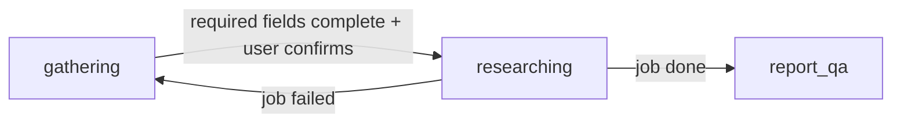

# 12 — Chat Workspace (conversational intake + report QA)

The product surface becomes a **chat-first workspace** (Gemini/GPT-style): the user
talks to Rumper; the assistant *guides* intake field-by-field, triggers the deep-research
graph (docs/11), then answers questions **grounded in the report only**. The Typeform-style
form (docs/09 v1) remains at `/form` as the operations fallback.

## 0. The chat lives in the assistant rail (docs/16)

In the three-region workspace (docs/16) the chat is the **assistant rail** — a fixed
~340px supporting column, not the dominant view. It must stay *subordinate* to the verified
analysis (assistant output is interpretation, never proof). Lifecycle:

- **New / single-column:** before any research, `/app` shows only the rail, expanded to a
  centered onboarding hero (docs/17) — one column.
- **Researching:** the rail shows a labeled **Deep Thinking** card (the docs/11 steps;
  ✓ done / current / waiting) — no fabricated tool logs.
- **report_qa:** the rail collapses to ~340px; the analysis (docs/16) and map (docs/14)
  regions appear. The report-ready turn shows a short summary + a **"Lihat detail laporan"**
  link that focuses the analysis region.

Rail header = "AI Assistant". The **Active Audit** selector (one audit = one conversation,
docs/13/§projects unused in UI) lists recent conversations with a state dot; **+** starts a
new single-column chat. The composer is pinned at the bottom; the standing disclaimer line
stays visible.

## 1. Why chat beats a form here (UVP framing)

A generic GPT/Gemini chat can do a shallow survey. Rumper's chat is different because
every answer is backed by: (a) the pre-collected geo warehouse (docs/10), (b) the
deep-research pipeline with citations and confidence labels, (c) the deterministic
scoring engine. The chat is the *interface*; the warehouse + graph are the moat.

## 2. Conversation lifecycle (server-side state machine)

- **gathering** — *legacy/fallback path*. Free-type LLM collection of `address_text`
  (+`property_name`), `workplace_text`, `transport_mode`, `purpose`, `concerns`. Superseded
  for new audits by the **guided wizard** (docs/17): a deterministic 7-step option flow that
  submits a structured intake (no LLM) and creates the conversation already in `researching`.
- **researching** — intake created (user profile supplies name; consents implied by
  login terms), research job started; chat replies status; frontend polls the job.
- **report_qa** — every turn receives the report fact sheet (scores, findings,
  checklist) as context; the assistant answers from it, citing confidence labels, and
  may suggest follow-ups. **report_qa never starts new research** — a new audit is started
  via the **"+"** Active Audit button (→ docs/17 onboarding), not by typing in the thread.

## 3. One LLM call per turn (structured)

`ChatTurnDraft`: `{reply, intake_updates{field:value}, suggestions[≤4 short chips],
ready_to_research, off_topic}`. Code merges `intake_updates` into the conversation's
intake draft, decides state transitions, never lets the LLM call tools directly.

## 4. Guardrails (not a common chatbot)

- System prompt scopes the assistant to **location-risk for Indonesian homebuyers**:
  intake gathering, explaining the methodology/categories, and report QA. Anything else
  → `off_topic=true` + a polite one-line redirect (code appends the standard steering
  copy; the model cannot freestyle off-domain answers).
- In `report_qa`, factual claims must come from the supplied fact sheet; if not in the
  report → say so and point to the field-validation checklist (no new research from chat).
- No certainty language; no recommendations beyond the engine's; disclaimer stays
  visible in the UI footer of the report panel.
- Every turn is metered and quota-checked **before** the LLM call (docs/13).

## 5. Suggestion chips

Each assistant turn returns ≤4 short chips (≤30 chars, id-ID) — next-step answers or
questions ("Naik KRL tiap hari", "Apa itu skor banjir?", "Mulai analisis sekarang").
Hero screen shows starter chips from code (not LLM): "Cek rumah incaran di Bekasi",
"Seberapa rawan banjir area ini?", "Commute ke SCBD realistis nggak?".

## 6. API (extends docs/05)

| Endpoint | Notes |
|---|---|
| `POST /api/projects` `{name}` · `GET /api/projects` | project = folder of conversations |
| `POST /api/conversations` `{project_id?}` · `GET /api/conversations` | Active Audit list; each row enriched with `property_name`, `rls_score`, `band`, `band_label`, `review_state` (joined Intake+Report) |
| `POST /api/conversations/from-intake` | **guided-wizard submit** (docs/17): structured intake (`address_text`, `property_name?`, `workplace_text`, `transport_mode`, `concerns[]`, `concern_notes?`, `purpose?`, `buying_stage?`, `dp_timeline?`) → creates a conversation, seeds the first message, starts research (no LLM). `201 {conversation_id, intake_id}`; geocode-fail → `400` |
| `GET /api/conversations/{id}` | messages + state + intake draft + job/report refs |
| `POST /api/conversations/{id}/messages` `{content}` | runs one chat turn; returns assistant message, chips, state, `intake_id?` |
| `GET /api/checks/{intake_id}/map` | map payload (docs/14) |

All require auth (docs/13). 402 `quota_exceeded` when over the token cap.
Conversation titles: first user message, truncated 60 chars.

## 7. Two-Way UI Synchronization

The chat workspace and map region (docs/14) must remain visually synchronized to build trust in the AI findings:
- **Hover to Map:** Hovering over a specific finding (e.g., "SUTET Power Line") in the chat or analysis panel automatically switches the map to the corresponding tab (e.g., Red Flags) and pulses the relevant geographic marker.
- **Click to Scroll:** Clicking an Evidence Card on the map scrolls the left analysis panel to the corresponding text finding.
