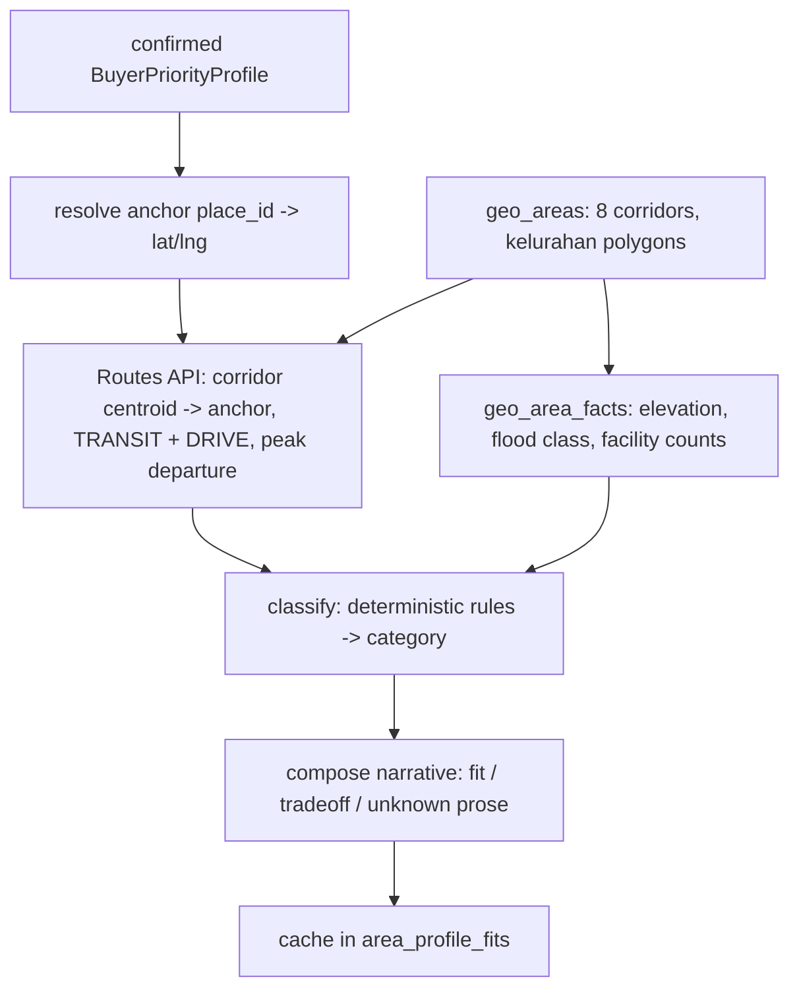

# 21 — Curated Areas: API design + agent workflow

> **Status:** Design · 2026-08-30 · needs approval before implementation
> **Implements:** PRD-12 (peta rekomendasi wilayah) · docs/18 GAP-03/04/05/06/08/13/18
> **Depends on:** [19 — Area boundaries & flood mapping](19-area-boundary-and-flood-mapping.md) Wave B
> **Status update 2026-08-30:** phases A–C are **implemented** — `GET /api/areas`
> (`services/areas.py`, `routers/areas.py`, `prompts/area_brief.md`) returns real commute,
> elevation, flood and facility data; the hub renders it on Google Maps. The mock seam is
> gone. Still deferred: corridor **polygons** (doc 19 Wave B — corridors are representative
> points today), shortlist persistence (GAP-06), price (GAP-13), headway (GAP-08).

---

## 1. What the screen actually renders

Field inventory taken from the shipped hub markup, not from the PRD prose — this is what an
API has to satisfy.

| Region | Rendered value | Source needed |
|---|---|---|
| Header | plan badge, `N lokasi tersisa`, avatar | **entitlements** (docs/18 §6.3) |
| Sub-header | corridor count, shortlist count | areas + shortlist |
| Sidebar filter | 3 category pills **with counts** (5 / 2 / 1) | derived from areas |
| Area card | category + label, name, region | area record |
| Area card | `~38 Menit` commute | **per-buyer** routing to their anchor |
| Area card | `Rp 950 Jt – 2,8 M` | land-value zone (§7) |
| Area card | `28 mdpl` elevation | aggregate over the polygon |
| Area card | bookmark state | shortlist |
| Map | gravity-centre marker (`Sudirman (Pusat Aktivitas)`) | **the buyer's own primary anchor** |
| Map | area markers + commute chip | area centroid + routing |
| Map | route polyline area → anchor | Routes API polyline |
| Map | radius rings 10/20/35 km | client-side from the anchor |
| Map | layer toggles Banjir / Transit / Radius | hazard tiles (doc 19 §7) |
| Map | search "Cari koridor…" | client-side over the loaded set |
| Detail card | `Mengapa Selaras` / `Kompromi Nyata` narrative | **composed prose** (§6) |
| Detail drawer | transit options + headway, essential facilities | warehouse + GTFS (GAP-08) |
| Footer | `Sintesis BNPB & BIG 2024`, `8 Koridor Terverifikasi` | provenance + vintage |

### The load-bearing consequence

**`GET /api/areas` cannot be a static list.** Four of the fields above — commute minutes,
the route polyline, the fit category, and the narrative — are functions of *this buyer's*
profile. Two buyers looking at Bintaro on the same day must see different commute figures and
possibly different categories. The mock's fixed `SUDIRMAN_GRAVITY_CENTER` and hardcoded
`commuteMinutes` hide this; the real endpoint is profile-scoped or it is wrong.

---

## 2. Data model

Builds directly on doc 19 §6 (`geo_areas`, `geo_area_members`, `geo_area_facts`). Additions:

```
area_profile_fits            -- per (corridor, profile version): the personalised layer
  corridor_id   uuid fk geo_areas
  profile_id    uuid fk buyer_profiles
  profile_version int         -- recompute trigger; results are reproducible per version
  category      text          -- strong_fit | interesting_tradeoff | challenge_assumptions
  commute       jsonb         -- {minutes, mode, polyline, departure_window, computed_at}
  fit_reasons   jsonb         -- [{key, text, evidence_ids[]}]
  tradeoffs     jsonb
  unknowns      jsonb         -- explicit gaps (PRD-11 FR-1112)
  computed_at   timestamptz
  primary key (corridor_id, profile_id)

shortlists
  user_id uuid · corridor_id uuid · created_at   -- primary key (user_id, corridor_id)
```

`area_profile_fits` is a **cache of a deterministic computation**, not a source of truth. It
can be dropped and rebuilt. `profile_version` is stored so a result stays reproducible after
the buyer edits priorities (PRD-11 §9 scoring boundary).

---

## 3. Endpoints

```
GET  /api/areas
     → 200 {anchor, areas[], meta}
     412 when no confirmed profile — the client sends the buyer to /app/start

GET  /api/areas/{area_id}          → deep-dive drawer payload
GET  /api/areas/{area_id}/geometry → boundary polygon (doc 19 §7)
POST /api/areas/{area_id}/shortlist    · DELETE  → {shortlisted, count}
GET  /api/areas/compare?ids=a,b,c  → comparison matrix (pending GAP-15)
```

### `GET /api/areas` response

```json
{
  "anchor": {
    "label": "Sudirman / SCBD",
    "place_id": "ChIJ…",
    "lat": -6.215, "lng": 106.82
  },
  "areas": [
    {
      "id": "…", "code": "3674", "name": "Bintaro & Pondok Aren",
      "region": "Tangerang Selatan",
      "category": "interesting_tradeoff",
      "category_label": "Kompromi Menarik",
      "centroid": {"lat": -6.288, "lng": 106.726},
      "commute": {
        "minutes": 38, "mode": "TRANSIT",
        "polyline": "<encoded>",
        "departure_window": "weekday_07_00_wib",
        "computed_at": "2026-08-30T02:00:00Z"
      },
      "elevation": {
        "median_m": 28, "p10_m": 19,
        "method": "median of 64-point grid across 3 kelurahan"
      },
      "land_value": {
        "min_idr_per_m2": 4200000, "max_idr_per_m2": 11500000,
        "source": "ZNT ATR/BPN 2025", "note": "nilai tanah zona — bukan harga rumah"
      },
      "flood": {"class": "sedang", "index": 0.41,
                "resolution_note": "indeks regional — bukan pengukuran per-RT"},
      "fit_reasons":  [{"key": "commute_reliability", "text": "…", "evidence_ids": ["…"]}],
      "tradeoffs":    [{"key": "future_space", "text": "…", "evidence_ids": ["…"]}],
      "unknowns":     [{"field": "drainage_capacity", "text": "…",
                        "suggested_action": "Tanya RT saat survei"}],
      "shortlisted": true,
      "facilities": {"hospital": 3, "school": 12, "market": 4, "nearest_station_km": 0.6},
      "transit": [{"type": "krl", "label": "Stasiun Jurang Mangu",
                   "distance_km": 0.6, "headway_min": null}]
    }
  ],
  "meta": {
    "profile_version": 3,
    "counts": {"strong_fit": 5, "interesting_tradeoff": 2, "challenge_assumptions": 1},
    "sources": ["BIG RBI 1:10.000", "InaRISK BNPB", "Google Routes"],
    "computed_at": "2026-08-30T02:00:00Z"
  }
}
```

Note what is **absent**: no numeric fit score. PRD-12 §1.2 is explicit that a "4.8/5"-style
ranking is the anti-pattern being replaced. Category + reasons + tradeoffs + unknowns, never a
scalar the UI can sort by.

`headway_min: null` is deliberate — see §7.

---

## 4. Computation pipeline

Per (corridor × profile), on first request and on profile change:



**Deterministic (pure code, `services/areas.py`)** — everything that can be wrong in a way
that matters:

- commute minutes and polyline (Google Routes, `departureTime` at the buyer's peak window);
- elevation median/p10 over a sampling grid inside the polygon;
- flood class from the InaRISK raster;
- facility counts from `geo_features` inside the polygon;
- **category assignment**, from a versioned rule table: `strong_fit` when no confirmed
  dealbreaker is violated and commute ≤ tolerance; `interesting_tradeoff` when strong on ≥1
  priority with exactly one measurable compromise; `challenge_assumptions` when it violates a
  stated preference but scores well on an unstated one.

**Agent (§6)** — prose only.

---

## 5. Cost and caching

8 corridors × 2 modes = **16 Routes calls per profile**, plus a re-run whenever the buyer
edits their anchors or budget. At the Routes API's per-call price this is the dominant cost of
the hub, so:

- results cache in `area_profile_fits` keyed by `(corridor, profile_id)` and invalidate on
  `profile_version` change — not on every page view;
- commute is recomputed on a **24-hour** TTL, since peak-hour travel time is a typical, not a
  live, figure. The UI labels it as such (`departure_window`);
- the corridor set is small and fixed (8), so this is bounded per user, not per property.

Every Routes call is metered through the existing usage ledger path (docs/13 §3) so the unit
economics of the hub are visible from day one, exactly as LLM calls already are.

---

## 6. Agent workflow — the area brief composer

The only place an LLM is used here. It follows CLAUDE.md rule 1 (AI never owns the score) and
rule 4 (all LLM calls through `providers/llm.py`, prompts as `.md` in `app/prompts/`).

**Input** (structured, no free text): the computed facts from §4 — category, commute, elevation
stats, flood class, facility counts, the buyer's confirmed priorities and dealbreakers, and the
list of fields that came back empty.

**Output** (structured, validated):

```python
class AreaBrief(BaseModel):
    fit_reasons: list[Reason]     # 2–3, each cites a computed fact by key
    tradeoffs:   list[Reason]     # ≥1 when one is known
    unknowns:    list[Unknown]    # every empty field from the input, none invented
```

**Guardrails, enforced in code after the call:**

1. Every `Reason.key` must be a priority key present in the buyer's profile, and every fact
   referenced must exist in the input. A brief referencing a fact we did not compute is
   **rejected and regenerated**, then dropped to a template on second failure.
2. The composer **cannot change `category`** — it receives it and explains it. Classification
   stays in `scoring`-style pure code.
3. It cannot invent an unknown or omit one: `unknowns` must equal the input's empty-field set.
4. No numbers in prose that are not in the input — checked by extracting numerals and
   diffing against the fact sheet.
5. Prompt lives at `app/prompts/area-brief.md`; the mapping of priorities→language is
   versioned with it.

**Why an agent at all:** the same corridor has to be explained differently to a buyer whose
dealbreaker is flooding and one whose dealbreaker is commute. That is a phrasing problem over
a fixed fact set — the one thing an LLM is genuinely good at here, and the one thing that
cannot go numerically wrong if the guardrails above hold.

**Batch, not per-request:** 8 briefs are composed in one background job when the profile is
confirmed, so opening the hub is a DB read. This mirrors the research pipeline's shape
(docs/11) rather than blocking a page load on generation.

---

## 7. Open items that the API must not paper over

| Item | Decision needed | Interim contract |
|---|---|---|
| **Price** (GAP-13) | ADR-010 forbids listing-derived prices. ZNT/NJOP is land value per m², *not* house price, and the card currently implies the latter. | Ship `land_value` with its `note`, or omit the field. **Do not** relabel ZNT as "Kisaran Harga". |
| **Transit headway** (GAP-08) | No reliable open GTFS for KRL/TransJakarta headways. | `headway_min: null`; UI renders "jadwal belum terverifikasi", never a plausible-looking number. |
| **`registeredPropertiesCount` / `checkpointsCount`** (GAP-18) | We have no property inventory. | Drop from the contract, or redefine `checkpoints` as "items in our checklist template for this corridor" and rename accordingly. |
| **Comparison** (GAP-15) | `docs/00` §4 lists multi-property compare as out of scope. | `/compare` stays unimplemented until that scope statement is rewritten. |
| **Category thresholds** | "commute ≤ tolerance" needs a number, and it should come from the buyer, not from us. | Derive from the profile's stated tolerance; if absent, mark the area `unknowns` rather than guessing. |

---

## 8. Phasing

**A — read-only, real geometry.** doc 19 Wave B lands `geo_areas`. `GET /api/areas` returns
corridors with elevation, flood class and facility counts. Commute and narrative absent, shown
as unknowns. Replaces the mock; the amber "data contoh" banner comes down.

**B — personalisation.** Routes integration, category rules, `area_profile_fits`, shortlist
endpoints. This is the point at which the hub becomes buyer-specific.

**C — briefs.** The composer and `app/prompts/area-brief.md`, with the guardrail tests.

**D — map layers.** Hazard tiles (doc 19 §7) behind the Banjir toggle; the hub map rebuilt on
`@vis.gl/react-google-maps` (ADR-017), replacing the prototype's Leaflet screen.

Until A ships, `features/areas/api.ts` stays the single mock seam and the UI keeps saying so.


---

## 9. Curation → shortlist → report (implemented 2026-08-30)

Curation is the saving step, and it produces the first report. Three separate rules, kept
separate on purpose:

**Auto-shortlist (free, instant).** Every `strong_fit` and `interesting_tradeoff` corridor is
saved once per profile, `strong_fit` first, capped at the 5-location free tier. So 3 strong
fits → 3 saved; 2 strong + 1 tradeoff → 3 saved; 6 fitting → 5 saved and the weakest match is
the one dropped. `challenge_assumptions` is excluded: it is shown to widen the buyer's
options, not because we think it suits them.

**Minimum one.** A profile can legitimately yield no fitting corridor — a strict commute
tolerance against a distant anchor makes everything `challenge_assumptions`. Rather than
leave an empty shortlist and no report, the shortest-commute corridor is saved.

**Exactly one report is auto-generated**, not one per shortlisted corridor. A deep-research
run consumes a large share of the 50k *daily* token cap (docs/13 §4, `core/usage.py`), so
firing three would 402 partway and take ~9 minutes. The rest are generated on demand, each
spending a location. Seeding is idempotent per profile id, so a buyer who empties their
shortlist does not get it refilled on the next visit.

**A corridor report is an area Mini Check**, run on `"<name>, <region>"` via `geocode_smart`.
It is not a property check — it characterises the corridor, and a property-level check
refines it later. The UI must not present the two as the same claim.

Once a corridor has a report, its card opens it (`/app/c/:conversationId`) instead of
re-running research. The `Analisis N/5` meter counts corridors that actually have one.

Persistence is `localStorage` (`features/areas/shortlist.ts`) until
`POST /api/areas/{id}/shortlist` and a server-side area→intake link exist — GAP-06, and the
four functions in that module are the seam.
