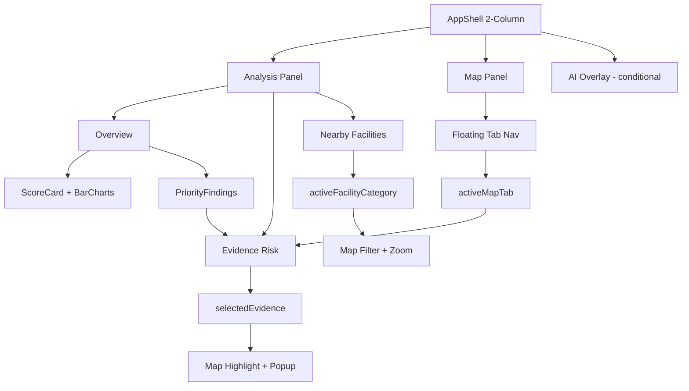

# PRD: Core Workspace Unified Implementation Blueprint

## Metadata

| Field | Value |
|-------|-------|
| **Author** | Antigravity AI |
| **Status** | Draft |
| **Created** | 2026-07-17 |
| **Last Updated** | 2026-07-18 |
| **Version** | 2.0 |
| **Related Docs** | `docs/12-chat-workspace.md`, `docs/14-map-delivery.md`, `docs/16-workspace-shell-and-analysis.md`, `docs/prd/core-workspace/core-workspace.md`, `docs/prd/core-workspace/evidence-risk-panel.md`, `docs/prd/core-workspace/map-tab-proof-engine.md`, `docs/prd/core-workspace/overview-panel.md`, `docs/prd/core-workspace/nearby-facilities-panel.md` |

---

## 1. Problem Statement

**Who** is affected and **what need** is unmet?

> The frontend and backend engineering teams lack a cohesive, unified system architecture for the Rumper Core Workspace. Currently, the same core concepts are scattered across multiple PRDs (Core Workspace, Evidence Risk Panel, Map Proof Engine, JTBD, Persona, User Flow, PRD). Treating these systems separately leads to fragmented state management, duplicated logic, and circular dependencies in the React component tree.

**Evidence:**
- Requirements are dispersed across at least 7 different product documents.
- Existing UI PRDs describe features component-by-component without a shared domain model.
- Components are independently managing overlapping state (e.g., `EvidencePanel.selected`, `Map.selected`, `Popup.selected`, `AI.selected`).

**Key Insight:**
We must shift from UI-driven component design to **domain-driven, state-first architecture**. By identifying the core business objects (Report, Evidence, Facility, Layer, Property, Conversation) and enforcing a single unidirectional data flow, we can eliminate state duplication and clearly define how features interact.

---

## 2. Goals

| # | Goal | Metric | Target |
|---|------|--------|--------|
| G1 | Unify Architecture | Number of state sources | 1 single `ReportState` |
| G2 | Eliminate Circular Dependencies | Dependency graph violations | 0 |
| G3 | Standardize Codebase Structure | Feature-based directory usage | 100% of new code in `src/features/` |
| G4 | Deliver Implementation Plan | Sprint completion | 8 Sprints executed in order |

---

## 3. Non-Goals

- **Not building:** A backend rewrite. The focus is on the frontend architecture and how it consumes the unified `Report` API.
- **Not solving for:** Real-time bi-directional syncing outside the unidirectional flow.
- **Not changing:** Existing backend scoring logic.
- **Deferred to future:** Generic UI improvements not tied to the core domain model unification.

---

## 4. Target Users

### Primary Persona
- **Who:** Frontend Engineer
- **Context:** Implementing the Rumper Core Workspace.
- **Motivation:** Needs a clear blueprint of what components to build, how they share state, and what the dependencies are.
- **Current workaround:** Guessing data flow and patching state sync bugs between map and panels.
- **Jobs to be done:** "As a frontend engineer, I want a single source of truth for state and event flow so that I can build synchronized map and panel interactions without spaghetti code."

---

## 5. User Stories & Key Flows

### Story 1: Selecting Evidence synchronizes the UI
**As a** user exploring the report, **I want to** click an evidence item and see it highlighted everywhere, **so that** I can easily connect textual findings to geospatial reality.

**Flow:**
1. User clicks evidence in the Analysis Panel.
2. `Click Evidence` event is dispatched.
3. Global state updates: `selectedEvidence = id`.
4. The Map component reacts, highlighting the relevant marker/polygon.
5. The Map Popup opens automatically based on `selectedEvidence`.

### Story 2: Map interaction updates the panels
**As a** user interacting with the map, **I want to** click a map marker and see its details in the panel, **so that** I don't have to manually search for it.

**Flow:**
1. User clicks a marker on the map.
2. `Marker clicked` event is dispatched.
3. Global state updates: `selectedEvidence = id`.
4. The Analysis Panel accordion expands to show the evidence.
5. The list scrolls the selected evidence into view.

### Story 3: Toggling layers filters the map
**As a** user, **I want to** toggle risk categories, **so that** I can isolate specific risks like floods or commute times.

**Flow (Toggle Switch):**
1. User switches a layer OFF.
2. `visibleLayers.remove(id)` is called on the global state.
3. Map component re-renders to hide the layer.

**Flow (Tab Click):**
1. User clicks the "Commute" tab.
2. Global state updates: `activeMapTab = 'commute'`.
3. Visible layers are filtered based on the active tab.
4. Map component re-renders.

### Story 4: Map tab syncs Analysis panel (Cross-Panel Sync)
**As a** user clicking map tabs, **I want to** see the Analysis panel automatically update to show the relevant evidence, **so that** I can read details alongside the map view.

**Flow:**
1. User clicks `Commute` pill on the Map floating nav.
2. State update: `activeMapTab = 'commute'`.
3. **Cross-sync:** Analysis panel automatically switches to `Evidence Risk` tab (`activeAnalysisTab = 'evidence'`).
4. Evidence list scrolls to and highlights the "Commute" category evidence rows.
5. Non-commute evidence rows dim (`opacity: 0.5`) to focus attention.

### Story 5: Analysis finding syncs Map (Cross-Panel Sync)
**As a** user clicking a finding card in the Overview, **I want to** see the Map update to show the relevant geospatial evidence, **so that** I can visually confirm what I just read.

**Flow:**
1. User clicks a `FindingCard` ("Ketahanan Banjir") on the Overview panel.
2. State update: `activeAnalysisTab = 'evidence'`, `selectedEvidence = flood_id`.
3. **Cross-sync:** Map floating nav switches to `Red Flags` tab (`activeMapTab = 'red-flags'`).
4. Map zooms to the flood zone polygon and highlights it with a pulsing animation.

### Story 6: AI Assistant expand/collapse
**As a** user needing clarification on a finding, **I want to** open the AI chat without leaving the workspace, **so that** I can get answers in context.

**Flow:**
1. User clicks the AI floating button or types in the chat input.
2. State update: `assistantOpen = true`.
3. **Layout shift:** A ~380px AI column appears between Analysis and Map.
4. Map panel compresses from the left to accommodate.
5. User clicks collapse icon (↗) at the top-right of the AI column header.
6. State update: `assistantOpen = false`.
7. **Layout shift:** Map panel stretches back to full width (~60% of viewport).

---

## 6. Solution Overview

**Approach:** 
Organize the app by feature (`analysis`, `assistant`, `map`, `report`) rather than UI type, backed by a single unidirectional state store (`ReportState`) where the API payload (`Report`) is the ultimate source of truth.

**Key Design Decisions:**

1. **Domain-Driven Entities.** The architecture centers around six business objects: `Report`, `Evidence`, `Facility`, `Layer`, `Property`, `Conversation`. Everything else is UI. The `Report` is the root, containing `score`, `overview`, `evidence[]`, `facilities[]`, `layers[]`, and `metadata`.
2. **Feature-Based Folder Structure.** Use `src/features/*`, `src/shared/*`, and `src/app/*` instead of generic `components`, `hooks`, `pages` folders.
3. **Single Source of Truth State.** Instead of isolated component state, use one `ReportState` containing all UI coordination state (see §7 below).
4. **Unidirectional Data Flow.** `Backend -> Report API -> Report Store -> Analysis -> Map -> Assistant`. The assistant never updates the map directly; everything flows from the report state.
5. **Two-Region Layout with Floating AI.** The AppShell renders a 2-column grid (Analysis + Map). The AI Assistant is a conditional middle column overlay, hidden by default. When collapsed, the Map stretches to fill the available space.

---

## 7. Technical Scope

### ReportState (Global State Interface)

```typescript
interface ReportState {
  // Core report data
  report: Report | null;

  // Analysis panel
  activeAnalysisTab: 'overview' | 'evidence' | 'facilities';
  selectedEvidence: string | null;
  
  // Map panel  
  activeMapTab: 'overview' | 'red-flags' | 'commute' | 'facilities' | 'toll-access';
  visibleLayers: string[];
  
  // Facilities panel
  activeFacilityCategory: string | null;
  
  // AI Assistant
  assistantOpen: boolean;
}
```

### Affected Architecture Layers

| Layer | Changes | Details |
|-------|---------|---------|
| **Frontend** | Major | Restructure to `features/` directory pattern. Implement global `ReportState`. 2-column AppShell with AI overlay. |
| **API** | Modified | Consolidate to a single `GET /checks/:id` returning the unified `Report`. |

### Database Changes
- [ ] New tables/models: None
- [ ] New fields on existing tables: None
- [ ] New enum values: None
- [ ] Migration strategy: Forward-only

### API Surface
- [ ] **Modified endpoints/procedures:** `GET /checks/:id` -> returns `Report` object including `overview`, `score`, `categories[]`, `priorityFindings`, `evidence`, `facilities_directory`, `layers`, `metadata`.

### Component Dependency Graph



### Cross-Panel Synchronization Matrix

| User Action | Source | State Changes | Target Effect |
|-------------|--------|---------------|---------------|
| Click Map pill (e.g., Commute) | Map | `activeMapTab='commute'`, `activeAnalysisTab='evidence'` | Analysis switches to Evidence tab, scrolls to Commute rows |
| Click Evidence accordion row | Analysis | `selectedEvidence=id` | Map highlights marker/polygon, opens popup |
| Click Finding Card (Overview) | Analysis | `activeAnalysisTab='evidence'`, `selectedEvidence=id`, `activeMapTab=category` | Map switches tab, zooms to evidence |
| Click Facility category row | Analysis | `activeFacilityCategory=cat` | Map filters POIs, zooms to fit bounds |
| Click Map marker/polygon | Map | `selectedEvidence=id` | Analysis scrolls to evidence row, expands accordion |
| Toggle evidence layer switch | Analysis | `visibleLayers.toggle(id)` | Map shows/hides the layer |
| Expand AI Assistant | Any | `assistantOpen=true` | AI column appears, Map compresses left |
| Collapse AI Assistant | Any | `assistantOpen=false` | AI column hides, Map stretches to full width |

---

## 8. Hypotheses & Assumptions

| # | Hypothesis | Validation Method | Status |
|---|-----------|-------------------|--------|
| H1 | We believe a single `ReportState` will eliminate map-panel synchronization bugs because it forces unidirectional flow. | We'll know we're right if zero state-sync bugs are reported during QA of Sprint 5. | Unvalidated |
| H2 | We believe the 2-column layout with floating AI is superior to the 3-column layout because it prioritizes evidence over AI chat. | We'll know we're right if map engagement time increases vs the 3-column design. | Unvalidated |

**Key assumptions that could invalidate this plan:**
- **Assumption 1: Complex state management library needed.** If the state is too large, native React context might cause excessive re-renders. **Mitigation:** Use a robust state manager like Zustand to allow component subscription to specific state slices (e.g., `selectedEvidence` only).

---

## 9. Success Metrics

### Primary KPI
- **Metric:** Architecture Compliance
- **Baseline:** 0% (Current scattered PRDs)
- **Target:** 100% of new UI features adhere to the single `ReportState` flow and `features/` directory structure.
- **Timeline:** End of Sprint 8

---

## 10. Risk Assessment (SVPG Framework)

| Risk Type | Level | Description | Mitigation |
|-----------|-------|-------------|------------|
| **Value** | Low | High value for development speed and app stability. | N/A |
| **Usability** | Low | 2-column layout is spacious; AI is on-demand. | N/A |
| **Feasibility** | Medium | Cross-panel synchronization is the most complex engineering challenge. | Strict enforcement of the Synchronization Matrix and unidirectional data flow. |
| **Viability** | Low | Standard frontend best practice. | N/A |

---

## 11. Dependencies & Risks

### Cross-Team Dependencies
- [ ] Engineering Team — Must agree to and adopt the feature-based folder structure and single state store.

---

## 12. Implementation Approach: Build Order

We will execute the implementation across 8 focused sprints:

### PR Breakdown Strategy

| # | PR Scope | Estimated Size | Dependencies | Labels |
|---|----------|---------------|--------------|--------|
| 1 | **Sprint 1: Foundation** (2-column AppShell, header without Tinjau Analis, routing, API types) | ~450 lines | None | `frontend`, `architecture` |
| 2 | **Sprint 2: Overview** (ScoreCard with ring + 5 bar charts, disclaimer, summary, findings) | ~350 lines | PR 1 | `frontend`, `ui` |
| 3 | **Sprint 3: Evidence Panel** (Accordion, badges, toggles, inline field checklist) | ~450 lines | PR 2 | `frontend`, `components` |
| 4 | **Sprint 4: Map** (Leaflet, floating top nav, interactive legend, zoom bottom-right) | ~550 lines | PR 1 | `frontend`, `map` |
| 5 | **Sprint 5: Synchronization** (Cross-panel sync per Synchronization Matrix above) | ~350 lines | PR 3, PR 4 | `frontend`, `state` |
| 6 | **Sprint 5.5: Nearby Facilities** (Category list, map filter sync) | ~250 lines | PR 4 | `frontend`, `ui` |
| 7 | **Sprint 6: AI Assistant** (Floating overlay column, expand/collapse, chat, Deep Thinking) | ~400 lines | PR 1 | `frontend`, `ai` |
| 8 | **Sprint 7: Optimization** (Memoization, lazy loading, mobile responsive, micro-animations) | ~250 lines | PR 5, PR 7 | `frontend`, `perf` |

**Total estimated size:** ~3050 lines across 8 PRs.

---

## 13. Stakeholder Sign-Off

| Role | Name | Status |
|------|------|--------|
| PM | [TODO] | [ ] Approved |
| Eng Lead | [TODO] | [ ] Approved |
| Design | [TODO] | [ ] Approved |
