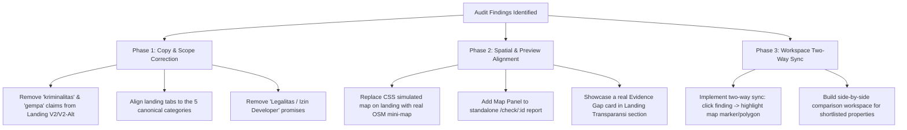

# Documentation: Gap Analysis — Landing Page V2 / V2-Alt vs. Core Workspace & Main Report

## Metadata

| Field | Detail |
|---|---|
| **Document Title** | Landing Page V2 / V2-Alt & Core Workspace Gap Analysis |
| **Product Module** | Landing & Access (`/v2`, `/v2-alt`) vs. Core Workspace (`/app/c/:threadId`, `/v2/workspace`, `/check/:id`) |
| **Status** | Approved / Living Documentation |
| **Created Date** | 2026-09-27 |
| **Author** | Antigravity AI Engineering & Product Team |
| **Related Documents** | `docs/prd/landing-and-access/landing-and-onboarding.md`, `docs/18-ux-revamp-adoption-analysis.md`, `docs/prd/core-workspace/unified-implementation-blueprint.md`, `prd-rumper-landing-page.md`, `docs/07-scoring-and-confidence.md` |

---

## 1. Executive Summary

Rumper's core mission is to provide first-time home buyers in Jabodetabek with an objective, independent location risk advisory before paying booking fees or down payments (DP). A core pillar of this value proposition is **correlation information**:
1. **Spatial-to-Text Visual Correlation:** Direct, bidirectional alignment between analytical claims/scores and geospatial proof (map polygons, POI pins, route lines).
2. **Evidence-to-Action Correlation:** A clear audit trail from raw grounded sources $\rightarrow$ evidence confidence $\rightarrow$ explicit data limitations/evidence gaps $\rightarrow$ field validation survey checklists.
3. **Personalization & Life-Fit Correlation:** Alignment between user lifestyle priorities (commute, family needs) and the resulting location score.
4. **Comparative Correlation:** Side-by-side multi-property risk benchmarking.

This document records the **comprehensive gap analysis** identifying where **Landing Page V2 (`LandingV2.tsx`) and V2-Alt (`LandingV2Alt.tsx`)** diverge from the reality of the **Core Workspace (`LocationWorkspace.tsx`, `LocationWorkspaceV2.tsx`, `stages.tsx`, `ReportMap.tsx`)** and the **Main Report (`Check.tsx`, `AnalysisWorkspace.tsx`)**.

> [!WARNING]
> **Summary Finding:** The Landing Page V2/V2-Alt and Core Workspace are currently **not equal**. Critical gaps exist in spatial fidelity, category taxonomy, data coverage claims (e.g. ungrounded crime/earthquake claims), two-way map synchronization, and comparative features.

---

## 2. Inventory of Evaluated Surfaces

| Surface | Source File | Route | Description |
|---|---|---|---|
| **Landing V1** | `frontend/src/components/Landing.tsx` | `/` | Shipped production landing page (Figma 1:1, green/teal theme). |
| **Landing V2** | `frontend/src/pages/v2/LandingV2.tsx` | `/v2` | Revamp beta landing page (split hero, interactive card stack, peeking carousel). |
| **Landing V2-Alt** | `frontend/src/pages/v2/LandingV2Alt.tsx` | `/v2-alt` | Alternative layout of V2 (centered hero, labeled card-stack tabs, pill buttons). |
| **Core Workspace (V1/Revamped)** | `frontend/src/pages/LocationWorkspace.tsx` | `/app/c/:threadId` | 5-Tahap location workspace backed by live backend APIs & Google Maps. |
| **Core Workspace (V2 Dev)** | `frontend/src/pages/v2/LocationWorkspaceV2.tsx` | `/v2/workspace` | Unified V2 workspace with mock & live support. |
| **V3 Map Platform / Shell** | `frontend/src/components/v3/ReportPanelV3.tsx` | `/dev/map-platform-v2` | Three-region layout with Leaflet map and category layer toggles. |
| **Classic Main Report** | `frontend/src/pages/Check.tsx` | `/check/:id` | Standalone operations fallback report rendering `AnalysisWorkspace.tsx`. |

---

## 3. Detailed Gap Findings

### Gap 1: Spatial & Visual Map Correlation (Simulated UI vs. Real Geodata)

* **Landing V2 / V2-Alt Presentation:**
  * Displays simulated CSS/SVG card mockups with stylized `.risk-zone` radial gradients, `.property-marker` dots, and SVG roads (`.road.r1`, `.road.r2`).
  * Claims exact hyper-local proximity metrics such as:
    * `"Area terdekat dari gerbang utama ±120 m"`
    * Visual radius halos on Grand Galaxy, Kota Wisata, BSD City, and PIK 2.
* **Core Workspace Reality:**
  * The actual workspace renders true GIS data using **OpenStreetMap / Google Maps**:
    * Administrative boundaries from **BIG** (1:10.000 kelurahan polygons).
    * Actual point locations of healthcare, education, transit, and retail from OpenStreetMap.
    * Real road network routing from **Google Routes API**.
  * **The Gap:** The workspace has **no concept of a "gerbang utama" (main gate)** or exact gated-cluster perimeter dataset. The landing page promises a level of micro-gate spatial precision that the backend warehouse cannot evidence.
* **Standalone Report Missing Map Gap:**
  * When a user views a report via `/check/:id` (`Check.tsx`), **zero map visualization is rendered**. It renders only textual cards, completely breaking the spatial correlation promised on the landing page.

---

### Gap 2: Two-Way Synchronization (Report Text $\leftrightarrow$ Map Canvas)

* **Landing V2 / V2-Alt & PRD Promise:**
  * `docs/prd/core-workspace/unified-implementation-blueprint.md` (Stories 1, 2, 4, 5) and `docs/prd/core-workspace/Map-Panel/.../prd.md` specify:
    * Clicking/hovering any finding or risk row in the report highlights the corresponding map marker/polygon and auto-zooms to it.
    * Clicking a map pin scrolls to and expands the corresponding evidence row in the report.
* **Core Workspace Reality:**
  * In `LocationWorkspace.tsx` and `LocationWorkspaceV2.tsx`, synchronization is implemented only at the coarse **Tahap level (01–05)** via an IntersectionObserver on scroll.
  * Clicking an individual finding in `Tahap02Evidence` does **not** trigger a highlight, pulse, or zoom on `ReportMap`.
  * **The Gap:** The granular, finding-level visual correlation promised in product documentation is missing in the shipped workspace.

---

### Gap 3: Taxonomy & Categorization Inconsistency

* **Landing Page Discrepancies:**
  * **Landing PRD (`prd-rumper-landing-page.md` §6):** Claims **"Satu Laporan, Enam Dimensi Utama"**:
    1. Skor Kelayakan Personal
    2. Risiko Banjir & Alam
    3. Waktu Tempuh & Mobilitas
    4. Aksesibilitas Fasilitas
    5. Akses Jalan & Prospek
    6. *Legalitas & Risiko Area* (sengketa wilayah, izin developer, batas zonasi).
  * **Landing V2 / V2-Alt Showcase Section (`#showcaseShell`):** Uses **4 tabs**:
    1. Banjir
    2. Lingkungan
    3. Akses
    4. *Sekitar* (merging facilities and surrounding).
  * **Landing V2 / V2-Alt Accordion Section (`#accordion`):** Uses **4 accordion items**:
    1. Risiko bencana
    2. Kondisi lingkungan
    3. Akses & mobilitas
    4. Kelayakan sekitar
* **Core Workspace & Backend Reality:**
  * The deterministic scoring engine (`backend/app/services/scoring.py` / `STD-SCR-001`) and the workspace UI strictly enforce **5 Standard Categories**:
    1. Ketahanan banjir (`banjir`)
    2. Efisiensi commute (`commute`)
    3. Akses fisik (`akses`)
    4. Fasilitas esensial (`fasilitas`)
    5. Lingkungan & red flag (`lingkungan`)
* **The Gap:**
  * **Legalitas Claim:** Neither the backend nor the workspace provides developer permit verification or land dispute checks (this is an explicit Non-Goal: *"We do not provide legal advice"*). Promising it on landing materials creates immediate compliance and expectation risks.
  * **Category Confusion:** Bouncing between 4 tabs, 5 categories, and 6 dimensions confuses users moving from the landing page into the onboarding wizard and workspace.

---

### Gap 4: Ungrounded Data Point & Hazard Coverage Claims

* **Landing V2 / V2-Alt Step 2 Carousel Claim:**
  * *"Mesin analitik kami memindai 40+ titik data termasuk riwayat banjir, kriminalitas, dan zona industri."* (LandingV2.tsx line 330, LandingV2Alt.tsx line 376).
  * Visual Orbit section displays *"Gempa"* (earthquake) as an active hazard satellite.
* **Core Workspace & Backend Reality:**
  * Rumper's warehouse monitors:
    * Banjir (InaRISK point hazard + BIG kelurahan boundary + DEM elevation).
    * Commute (Google Routes API peak vs. off-peak driving and transit).
    * Fasilitas (OSM POIs within 3 km).
    * Red Flags (SUTET, TPA / landfill, industrial zones, railway lines).
  * **The Gap:** **No crime / criminality (`kriminalitas`) dataset exists** anywhere in the Rumper backend or ingestion pipeline. Furthermore, seismic/earthquake data is not part of the active scoring model. Advertising crime data is a false claim that must be removed.

---

### Gap 5: Multi-Property Comparative Correlation (Side-by-Side Matrix)

* **Landing V2 / V2-Alt Presentation:**
  * Dedicated section: **"Masih pilih antara dua rumah? Bandingkan faktor lokasi secara berdampingan"** (LandingV2.tsx lines 391–418).
  * Displays comparison cards: *Lokasi A (Grand Galaxy City)* vs. *Lokasi B (Kota Wisata)* comparing Banjir, Akses, and Lingkungan.
  * Pricing tier claims: *"Rp129.000 / 30 hari: Hingga 5 properti, Perbandingan lokasi, Multi-commute & matriks perbandingan"*.
* **Core Workspace Reality:**
  * The workspace (`LocationWorkspace.tsx` / `LocationWorkspaceV2.tsx`) is built around a single `threadId` and single `intake_id`.
  * While `AreasHub` supports shortlisting corridors, the core workspace has **no side-by-side comparison screen** or multi-property matrix.
  * **The Gap:** Users who purchase or register expecting to compare two shortlisted houses side-by-side in the main workspace find only isolated, single-property reports.

---

### Gap 6: Personalization & Life-Fit Horizon Correlation

* **Landing Page Promise:**
  * Promotes *"Skor Kelayakan Personal"* and *"Kecocokan Hidup (Life Fit)"* with temporal progression (*Now: 90%, 3 Yrs: 80%, 5 Yrs: 70%*).
* **Core Workspace Reality:**
  * Rumper calculates a single **Location Risk Index / RLS Score (0–100)** representing current, point-in-time environmental and transit risks.
  * **The Gap:** There is no multi-year life-fit modeling or timeline projection algorithm in the scoring service.

---

### Gap 7: Evidence Gap Transparency & Empty State Demonstration

* **Landing Page Promise:**
  * Emphasizes transparency: *"Bukan angka aja. Lihat sumber dan batasannya"* and promises explicit *evidence gaps*.
  * However, the preview cards on Landing V2/V2-Alt only showcase standard findings with green/amber chips.
* **Core Workspace Reality:**
  * Core Workspace has a dedicated, robust **Evidence Gap architecture**:
    * When an external API (e.g. InaRISK or Google Routes) fails or has no data, the score falls back to `None` (`No data != Low risk`).
    * Tahap 02 explicitly renders an accordion for *"Catatan evidence gap"* with counts and field inspection instructions.
  * **The Gap:** The landing page fails to highlight this unique strength. Demonstrating an actual "Data Belum Cukup" card on the landing page would reinforce Rumper's stance of developer-independence.

---

### Gap 8: Nomenklatur Skor & Visual Branding

| Dimension | Landing V2 / V2-Alt | Core Workspace / Report | Impact |
|---|---|---|---|
| **Score Name** | "Location Risk Index", "Skor Kelayakan" | "Indeks Keselarasan Lokasi", "RLS Score", "Ringkasan Lokasi" | Inconsistent terminology across conversion funnel. |
| **Score Visual** | Handwritten Caveat font (`font-family: 'Caveat'`) `68/100` | Circular SVG progress gauge with semantic band badges | Disconnect between whimsical marketing art and serious engineering interface. |
| **Metric Chips** | Static preview chips ("4 temuan kritis", "1 temuan mobilitas") | Dynamic severity badges (`Alert`, `Warning`, `Info`) + confidence chips | Mismatched visual taxonomy. |

---

## 4. Comprehensive Comparison Matrix

| Feature / Correlation Dimension | Landing V2 / V2-Alt (`/v2`, `/v2-alt`) | Core Workspace (`/app/c/:id`, `/v2/workspace`) | Main Report (`/check/:id`) | Gap Severity | Root Cause |
|---|---|---|---|---|---|
| **Visual Map Canvas** | Simulated CSS/SVG roads & radial glows | Interactive Leaflet / Google Maps with OSM tiles & BIG boundaries | ❌ None (Text cards only) | 🔴 **High** | Standalone report omitted map; landing used static mockup. |
| **Two-Way Finding Sync** | Simulated tabs | Coarse stage-level scroll sync only | ❌ None | 🟡 **Medium** | Unidirectional implementation blueprint not yet fully wired. |
| **Category Structure** | 4 tabs / 4 accordion items | 5 canonical categories (`STD-SCR-001`) | 5 canonical categories | 🔴 **High** | Copy drift between design prototypes and backend schema. |
| **Legalitas & Developer Permits** | Promised in PRD / early copy | ❌ None (Explicit Non-Goal) | ❌ None | 🔴 **High** | Marketing copy overpromised beyond product scope. |
| **Crime / Kriminalitas Data** | Claimed in feature carousel (Step 2) | ❌ None | ❌ None | 🔴 **High** | Fabricated copy claim in landing carousel. |
| **Side-by-Side Comparison** | Featured Lokasi A vs B section | ❌ None (Single-property only) | ❌ None | 🔴 **High** | Multi-property matrix UI not yet built in workspace. |
| **Life-Fit Timeline (3/5 Yrs)** | Promised in PRD | ❌ None (Static point-in-time score) | ❌ None | 🟡 **Medium** | Futuristic PRD concept never implemented in backend. |
| **Evidence Gap Display** | Mentioned in copy, missing in preview | ✅ Dedicated accordion & badge | ✅ Dedicated note | 🟢 **Workspace Better** | Landing preview under-represents workspace capability. |
| **Field Validation Checklist** | Promoted as primary outcome | ✅ Tahap 04 interactive checklist | ✅ Checklist panel | 🟡 **Medium** | Checklist progress is currently client-side only (GAP-09). |

---

## 5. Actionable Remediation Roadmap

### Phase 1: Immediate Copy & Claims Cleanup (Sprint 1)
1. **Remove Ungrounded Claims:** Edit `LandingV2.tsx` and `LandingV2Alt.tsx` to remove references to `kriminalitas` (Step 2 Carousel) and `gempa` (Visual Orbit). Replace with verified red flags: SUTET, TPA, Kawasan Industri, and Rel Kereta Api.
2. **Harmonize Categories:** Standardize all landing sections to the **5 Canonical Categories**: *Ketahanan Banjir, Efisiensi Commute, Akses Fisik, Fasilitas Esensial, dan Lingkungan & Red Flags*.
3. **Harmonize Score Naming:** Align all headings to *Indeks Keselarasan Lokasi (Location Risk Index)*.

### Phase 2: Preview & Report Parity (Sprint 2)
1. **Real Spatial Preview on Landing:** Replace the static CSS `.risk-zone` simulation with an interactive Leaflet/OSM interactive preview widget illustrating how real InaRISK polygons and POI pins connect to claims.
2. **Restore Map to `/check/:id`:** Integrate the map component into `Check.tsx` using a split-view or drawer layout so standalone reports maintain full spatial correlation.
3. **Display True Evidence Gap Card:** Add a preview of an *Evidence Gap card* to the "Transparansi" section of the landing page to demonstrate Rumper's honest "No data != Low risk" philosophy.

### Phase 3: Core Workspace Feature Completeness (Sprint 3)
1. **Finding-to-Map Two-Way Sync:** Complete Story 1 & Story 5 from `unified-implementation-blueprint.md`: clicking any finding card in `Tahap02Evidence` dispatches `selectedEvidence`, causing the map to pan, zoom, and highlight the corresponding marker/polygon.
2. **Multi-Location Comparison Matrix:** Build a `/app/compare` or `/v2/compare` view allowing users to evaluate shortlisted properties side-by-side as promised in the landing comparison section.
