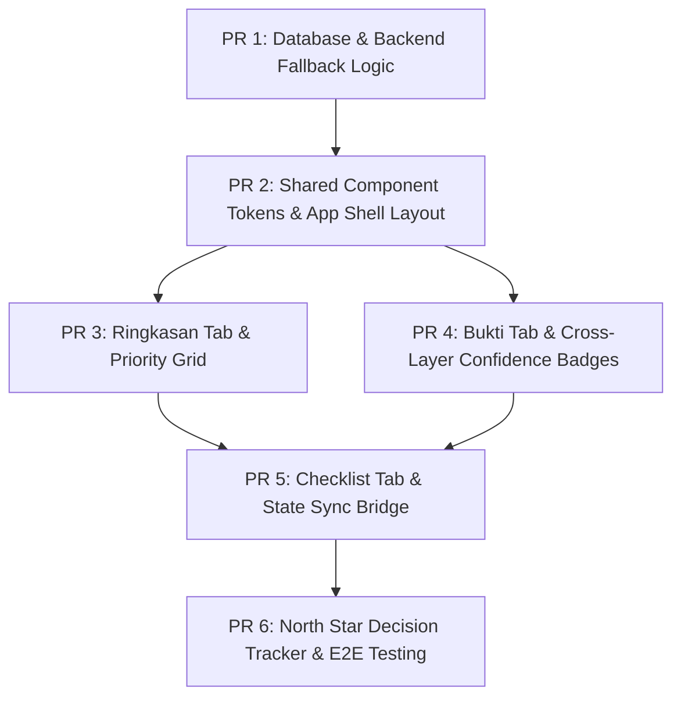

# PRD: Rumper Decision-Insight System

## Metadata

| Field | Value |
|-------|-------|
| **Author** | [TODO — PRD author name] |
| **Status** | Draft |
| **Created** | 2026-06-28 |
| **Last Updated** | 2026-06-28 |
| **Version** | 1.0 |
| **Related Docs** | `PRD rumah pertama.md`, `context.md`, `docs/16-workspace-shell-and-analysis.md`, `docs/prd/location-risk-dashboard.md`, `landing_page_vs_dashboard_content_mapping.md` |

---

## 1. Problem Statement

**Who** is affected and **what need** is unmet?

> First-time home buyers in Jabodetabek ("Si Commuter" and "Si Perencana") face severe information asymmetry when evaluating properties. Traditional dashboards overwhelm users with generic data features and false precision (e.g. a single arbitrary rating score). Buyers need a structured **decision-insight system** that guides them through a clear risk-elimination path before paying down payments, framing data around real-life implications, evidence limitations, and actionable field checks.

**Evidence:**
- Property platforms present static marketing claims ("100% bebas banjir") with zero independent verification or topografic contextualization.
- Home buyers struggle to translate raw metrics (e.g., "distance to station: 2.05 km") into daily lifestyle implications (e.g., commute hours per week).
- Incomplete datasets are often interpreted by buyers as "low risk" rather than "missing evidence" (data gaps).

**Key Insight:**
To build absolute trust, the system must treat location data not as a static score, but as a risk-reduction pipeline. The system must decouple the data categories (Banjir, Commute, etc.) from the trust metadata (Confidence), applying confidence as a cross-cutting layer across all observations, and forcing a strict hierarchy from high-level elimination to on-site validation.

---

## 2. Goals

| # | Goal | Metric | Target |
|---|------|--------|--------|
| G1 | Drive transparency and trust | Bukti tab opening rate | ≥ 70% of users open and read the detailed evidence tab |
| G2 | Verify data gaps in the field | Checklist engagement | ≥ 60% of users interact with at least 3 custom check items |
| G3 | Clarify user next steps | Decision readiness score | ≥ 80% of users report knowing their exact next step after reading the report |

---

## 3. Non-Goals

- Providing financial, mortgage, or legal contract advice.
- Predicting exact property appreciation rates or investment forecasts.
- Eliminating all physical verification steps (Rumper acts as a pre-survey desk advisor, not a replacement for site visits).

---

## 4. Target Users & Decision Mapping

### Primary Persona: "Si Commuter"
- **Top Decisions:** Is this daily commute realistic? Is the property cheap but expensive in travel time?
- **Required Insights:** Commute Window (`MOB-01`), Commute Stability (`MOB-02`), Transit Dependency (`MOB-03`), Access Friction (`ACC-01`).

### Secondary Persona: "Si Perencana"
- **Top Decisions:** Is this area safe from catastrophic floods? Is the location viable for a 5-10 year family plan?
- **Required Insights:** Historical Flood Signals (`FLD-01`), Healthcare/Education Access (`FAM-01`, `FAM-02`), Neighborhood Red Flags (`NBH-01`).

---

## 5. Modular System Architecture

To ensure a structured and maintainable implementation, the Decision-Insight System is divided into four functional modules:

```text
┌────────────────────────────────────────────────────────────┐
│                    MODULE A: TRUST SCHEMA                  │
│  (Observation → Evidence → Interpretation → Limit → Action)│
└─────────────────────────────┬──────────────────────────────┘
                              ▼
┌────────────────────────────────────────────────────────────┐
│                  MODULE B: DECISION HIERARCHY              │
│       Level 1 (Elimination) → Level 2 (Fit) → Level 3 (Trust)  │
└─────────────────────────────┬──────────────────────────────┘
                              ▼
┌────────────────────────────────────────────────────────────┐
│            MODULE C: EVIDENCE CONFIDENCE & GAP ENGINE      │
│   (Data Kuat · Data Sedang · Perlu Validasi · Gap Detect)  │
└─────────────────────────────┬──────────────────────────────┘
                              ▼
┌────────────────────────────────────────────────────────────┐
│              MODULE D: ACTIONABLE CHECKLIST BRIDGE         │
│          (Checklist Sync, Progress, & Decision Tracker)    │
└────────────────────────────────────────────────────────────┘
```

---

### Module A: Trust Model Schema (Database & Engine)
Every insight generated by Rumper’s research pipeline must follow a strict, standardized data schema to prevent arbitrary recommendations.

#### Data Schema Contracts (`findings` table):
1. **Observation (Claim):** The raw finding statement in Bahasa Indonesia.
2. **Evidence:** The array of sources backing the claim (Source Title, URL, Date).
3. **Interpretation:** Plain-language explanation of what the finding means for the buyer's daily life.
4. **Limitation:** Clear caveats explaining why the data might not apply to their specific home.
5. **Action:** Concrete fieldwork step required to verify the claim.

#### Codebase Reference:
- Maps directly to the existing Python dataclass `Finding` in `backend/app/models/` and the PostgreSQL `findings` table.

---

### Module B: Decision Hierarchy (UX Layout & Priority)
The interface must present information in a vertical hierarchy that matches the user’s cognitive flow when evaluating a property:

#### 1. Level 1 — Elimination (Catastrophic Risks first)
- **UI Element:** Red-flag Alert Panel.
- **Behavior:** Placed at the very top of the Ringkasan workspace. If any `is_critical` finding exists, it blocks access to positive dimensions until dismissed or acknowledged.
- **Purpose:** Help users immediately filter out unviable properties (e.g. massive flood zones).

#### 2. Level 2 — Fit Evaluation (Tradeoffs & Implications)
- **UI Element:** Ringkasan Narrative & Human-Scale Commute Widgets.
- **Behavior:** Renders raw statistics alongside lifestyle calculations:
  - *Example:* Instead of showing "87 mins commute", show: `"Commute Anda memakan waktu 3 jam/hari (±15 jam/minggu). Ini mengurangi waktu keluarga Anda."`

#### 3. Level 3 — Confidence Building (Validation)
- **UI Element:** Tab Bukti and Tab Checklist.
- **Behavior:** Lists raw sources, data limitations, and specific check steps.

---

### Module C: Evidence Confidence & Gap Engine
Confidence is a **cross-cutting layer** attached to individual findings, rather than a separate taxonomic category.

#### Confidence Levels & UI Behaviors:
- **Data kuat (High):** Retains standard layout.
- **Data sedang (Medium):** Appends subtle validation advice badge.
- **Perlu validasi (Low):** Automatically highlights the card border in orange/yellow and duplicates the `Action` field to the Checklist tab.
- **Data belum cukup (Gap):** Triggered when critical datasets fail. Removes the rating recommendation and displays a dedicated *Evidence Gap Card*:
  - *Format:* `"Sistem tidak menemukan data historis banjir di kelurahan ini. Wajib survei langsung ke warga."`

#### Codebase Reference:
- Enforce the rule `No data != Low risk` in `backend/app/services/scoring.py`. Null values must fall back to "Evidence Gap" instead of default positive status.

---

### Module D: Actionable Checklist Bridge
Bridges online research findings with offline physical due diligence.

#### Components:
- **Checklist Sync Panel:** Allows users to see checkboxes directly linked to specific findings in Tab Bukti. Checking an item tracks their physical validation progress.
- **Progress Indicator:** Horizontal track showing `"Progres X dari Y selesai"` to encourage active field validation.
- **North Star Decision Tracker:** An interactive exit widget at the bottom of the Ringkasan tab asking:
  - `"Apakah laporan ini mengubah keputusan Anda tentang lokasi ini?"`
  - Options: `Ya, cari lokasi lain (Skip)` | `Ya, saya harus survei dulu (Validate)` | `Tidak, tetap lanjut (Proceed)`.

---

## 6. Technical Scope

### Affected Architecture Layers

| Layer | Changes | Details |
|-------|---------|---------|
| **Database** | Minor | Ensure `findings` schema columns (`claim`, `evidence`, `limitation`, `validation_action`) are fully enforced with foreign key constraints. |
| **Backend** | Modified | Adjust `scoring.py` to prevent default low-risk scoring on empty data hooks. Handle `data_belum_cukup` as a distinct status. |
| **Frontend** | Modified | Implement Split-Pane workspace, responsive Mobile float triggers, and Checklist Tab state synchronization. |
| **API** | None | Keep endpoints (`GET /api/checks/{id}`) aligned with the current contract. |

---

## 7. Hypotheses & Assumptions

- **Hypothesis H1:** Displaying the exact data limitation on each card increases overall user trust and conversion to expert reviews.
- **Hypothesis H2:** Replacing a single numerical score with a "Decision Impact Tracker" widget increases user engagement and checklist utilization.
- **Assumption:** Google Maps Routing and InaRISK BNPB API payloads contain sufficient raw data to populate the `limitation` structures.

---

## 8. Implementation Approach

### PR Breakdown Strategy



| PR | Scope | Estimated Size | Dependencies |
|----|-------|---------------|--------------|
| **1** | Backend: Refactor `scoring.py` and data schemas for fallback handling | ~250 lines | None |
| **2** | Frontend: Scaffold App Shell, Split-Pane layout, and Responsive triggers | ~350 lines | None |
| **3** | Frontend: Ringkasan tab, Red-Flag banners, and Priority card grid | ~400 lines | PR 2 |
| **4** | Frontend: Bukti tab, metadata contrast fixes, and neutral limitation boxes | ~300 lines | PR 2 |
| **5** | Frontend: Checklist tab, checkboxes interaction, progress tracker sync | ~300 lines | PR 3, PR 4 |
| **6** | Integration: North Star exit poll widget and E2E Cypress tests | ~200 lines | PR 5 |

---

## 9. Success Metrics

- **Primary KPI:** North Star Alignment Rate (percentage of users selecting a clear next step in the Exit Widget) > 85%.
- **Engagement Guardrail:** Bounce rate on `/app/c/{id}` remains under 35%.
- **Conversion KPI:** WhatsApp expert review requests increase by 15% post-implementation.

---

## Appendix

### Change Log
| Date | Version | Changes |
|------|---------|---------|
| 2026-06-28 | 1.0 | Initial release of the Decision-Insight System PRD with modular system architecture specs. |
